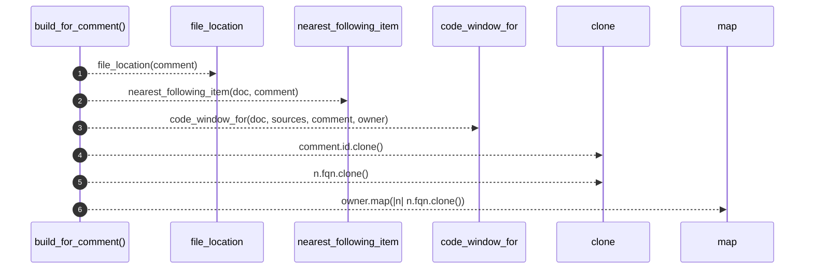

# `robby_agent::context::build_for_comment`

[Self-model](../../README.md) · [context](index.md)

| | |
|---|---|
| kind | `code.function` |
| signature | `fn build_for_comment(     doc: &Document,     sources: &BTreeMap<String, String>,     comment: &Node,     text: String, ) -> CommentContext` |
| location | [`crates/robby-agent/src/context.rs:87`](../../../../crates/robby-agent/src/context.rs#L87) |
| provenance | extractor · confidence 1.00 |

```rust
fn build_for_comment(
    doc: &Document,
    sources: &BTreeMap<String, String>,
    comment: &Node,
    text: String,
) -> CommentContext {
    let (file, location) = file_location(comment);
    let owner = nearest_following_item(doc, comment);
    let code_window = code_window_for(doc, sources, comment, owner);
    CommentContext {
        parent_id: comment.id.clone(),
        comment_text: text,
        code_window,
        owner_fqn: owner.map(|n| n.fqn.clone()),
        file,
        location,
    }
}
```



6 steps · 0 observed · 6 possible only

**Edges**

- calls → [`robby_agent::context::file_location`](file-location.md)
- calls → [`robby_agent::context::nearest_following_item`](nearest-following-item.md)
- calls → [`robby_agent::context::code_window_for`](code-window-for.md)

## References

- calls → [`robby_agent::context`](index.md) — code_window_for, file_location, nearest_following_item

## Referenced by

- calls ← [`robby_agent::context::collect_comment_contexts`](collect-comment-contexts.md)

