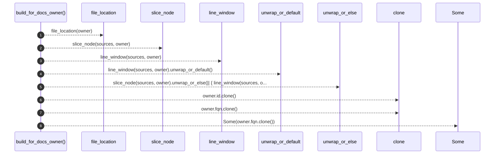

# `robby_agent::context::build_for_docs_owner`

[Self-model](../../README.md) · [context](index.md)

| | |
|---|---|
| kind | `code.function` |
| signature | `fn build_for_docs_owner(     doc: &Document,     sources: &BTreeMap<String, String>,     owner: &Node,     text: String, ) -> CommentContext` |
| location | [`crates/robby-agent/src/context.rs:106`](../../../../crates/robby-agent/src/context.rs#L106) |
| provenance | extractor · confidence 1.00 |

```rust
fn build_for_docs_owner(
    doc: &Document,
    sources: &BTreeMap<String, String>,
    owner: &Node,
    text: String,
) -> CommentContext {
    let (file, location) = file_location(owner);
    let code_window = slice_node(sources, owner).unwrap_or_else(|| {
        line_window(sources, owner).unwrap_or_default()
    });
    let _ = doc;
    CommentContext {
        parent_id: owner.id.clone(),
        comment_text: text,
        code_window,
        owner_fqn: Some(owner.fqn.clone()),
        file,
        location,
    }
}
```



8 steps · 0 observed · 8 possible only

**Edges**

- calls → [`robby_agent::context::file_location`](file-location.md)
- calls → [`robby_agent::context::slice_node`](slice-node.md)
- calls → [`robby_agent::context::line_window`](line-window.md)

## References

- calls → [`robby_agent::context`](index.md) — file_location, line_window, slice_node

## Referenced by

- calls ← [`robby_agent::context::collect_comment_contexts`](collect-comment-contexts.md)

