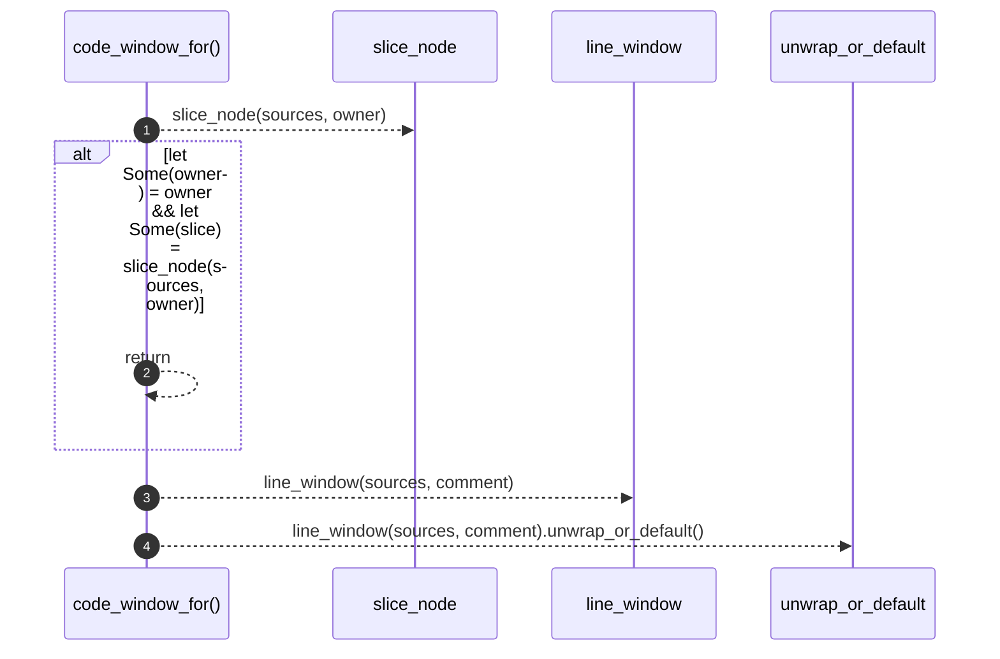

# `robby_agent::context::code_window_for`

[Self-model](../../README.md) · [context](index.md)

| | |
|---|---|
| kind | `code.function` |
| signature | `fn code_window_for(     _doc: &Document,     sources: &BTreeMap<String, String>,     comment: &Node,     owner: Option<&Node>, ) -> String` |
| location | [`crates/robby-agent/src/context.rs:133`](../../../../crates/robby-agent/src/context.rs#L133) |
| provenance | extractor · confidence 1.00 |

```rust
fn code_window_for(
    _doc: &Document,
    sources: &BTreeMap<String, String>,
    comment: &Node,
    owner: Option<&Node>,
) -> String {
    if let Some(owner) = owner
        && let Some(slice) = slice_node(sources, owner)
    {
        return slice;
    }
    line_window(sources, comment).unwrap_or_default()
}
```



4 steps · 0 observed · 4 possible only

**Edges**

- calls → [`robby_agent::context::slice_node`](slice-node.md)
- calls → [`robby_agent::context::line_window`](line-window.md)

## References

- calls → [`robby_agent::context`](index.md) — line_window, slice_node

## Referenced by

- calls ← [`robby_agent::context::build_for_comment`](build-for-comment.md)

