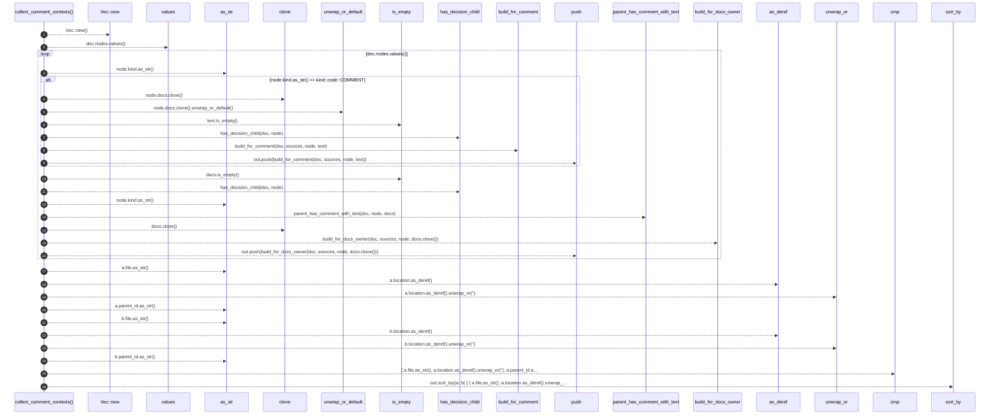

# `robby_agent::context::collect_comment_contexts`

[Self-model](../../README.md) · [context](index.md)

| | |
|---|---|
| kind | `code.function` |
| signature | `fn collect_comment_contexts(     doc: &Document,     sources: &BTreeMap<String, String>, ) -> Vec<CommentContext>` |
| location | [`crates/robby-agent/src/context.rs:17`](../../../../crates/robby-agent/src/context.rs#L17) |
| provenance | extractor · confidence 1.00 |

> Collect enrichable comment/docs contexts under the whole document.

```rust
/// Collect enrichable comment/docs contexts under the whole document.
pub fn collect_comment_contexts(
    doc: &Document,
    sources: &BTreeMap<String, String>,
) -> Vec<CommentContext> {
    let mut out = Vec::new();

    for node in doc.nodes.values() {
        if node.kind.as_str() == kind::code::COMMENT {
            let text = node.docs.clone().unwrap_or_default();
            if text.is_empty() {
                continue;
            }
            if has_decision_child(doc, node) {
                continue;
            }
            out.push(build_for_comment(doc, sources, node, text));
            continue;
        }

        // Docs-only: item docs with no covering comment node already enriched.
        let Some(docs) = &node.docs else {
            continue;
        };
        if docs.is_empty() || has_decision_child(doc, node) {
            continue;
        }
        if node.kind.as_str() == kind::code::COMMENT {
            continue;
        }
        // Skip if a comment node already carries the same text under the same parent.
        if parent_has_comment_with_text(doc, node, docs) {
            continue;
        }
        out.push(build_for_docs_owner(doc, sources, node, docs.clone()));
    }

    out.sort_by(|a, b| {
        (
            a.file.as_str(),
            a.location.as_deref().unwrap_or(""),
            a.parent_id.as_str(),
        )
            .cmp(&(
                b.file.as_str(),
                b.location.as_deref().unwrap_or(""),
                b.parent_id.as_str(),
            ))
    });
    out
}
```



26 steps · 0 observed · 26 possible only

**Edges**

- calls → [`robby_agent::enrich::impl FakeClient::new`](../enrich/tests/index.md)
- calls → [`robby_agent::model::impl Verdict::as_str`](../model/index.md)
- calls → [`robby_ir::span::impl Span::is_empty`](../../robby_ir/span/index.md)
- calls → [`robby_agent::context::has_decision_child`](has-decision-child.md)
- calls → [`robby_agent::context::build_for_comment`](build-for-comment.md)
- calls → [`robby_render::report::impl Report::push`](../../robby_render/report/index.md)
- calls → [`robby_ir::span::impl Span::is_empty`](../../robby_ir/span/index.md)
- calls → [`robby_agent::context::has_decision_child`](has-decision-child.md)
- calls → [`robby_agent::model::impl Verdict::as_str`](../model/index.md)
- calls → [`robby_agent::context::parent_has_comment_with_text`](parent-has-comment-with-text.md)
- calls → [`robby_agent::context::build_for_docs_owner`](build-for-docs-owner.md)
- calls → [`robby_render::report::impl Report::push`](../../robby_render/report/index.md)
- calls → [`robby_agent::model::impl Verdict::as_str`](../model/index.md)
- calls → [`robby_agent::model::impl Verdict::as_str`](../model/index.md)
- calls → [`robby_agent::model::impl Verdict::as_str`](../model/index.md)
- calls → [`robby_agent::model::impl Verdict::as_str`](../model/index.md)

## References

- calls → [`robby_agent::context`](index.md) — build_for_comment, build_for_docs_owner, has_decision_child, parent_has_comment_with_text
- calls → [`robby_agent::enrich::tests`](../enrich/tests/index.md) — new
- calls → [`robby_agent::model`](../model/index.md) — as_str
- calls → [`robby_ir::span`](../../robby_ir/span/index.md) — is_empty
- calls → [`robby_render::report`](../../robby_render/report/index.md) — push

## Referenced by

- calls ← [`robby_agent::enrich::enrich_comments`](../enrich/enrich-comments.md)

