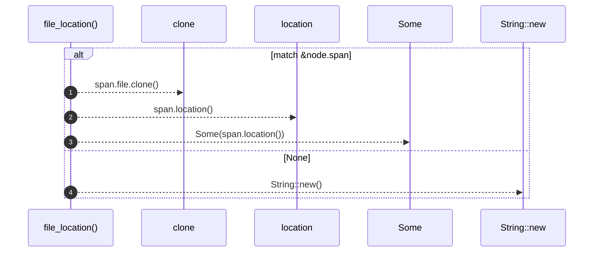

# `robby_agent::context::file_location`

[Self-model](../../README.md) · [context](index.md)

| | |
|---|---|
| kind | `code.function` |
| signature | `fn file_location(node: &Node) -> (String, Option<String>)` |
| location | [`crates/robby-agent/src/context.rs:127`](../../../../crates/robby-agent/src/context.rs#L127) |
| provenance | extractor · confidence 1.00 |

```rust
fn file_location(node: &Node) -> (String, Option<String>) {
    match &node.span {
        Some(span) => (span.file.clone(), Some(span.location())),
        None => (String::new(), None),
    }
}
```



4 steps · 0 observed · 4 possible only

**Edges**

- calls → [`robby_ir::span::impl Span::location`](../../robby_ir/span/index.md)
- calls → [`robby_agent::enrich::impl FakeClient::new`](../enrich/tests/index.md)

## References

- calls → [`robby_agent::enrich::tests`](../enrich/tests/index.md) — new
- calls → [`robby_ir::span`](../../robby_ir/span/index.md) — location

## Referenced by

- calls ← [`robby_agent::context::build_for_comment`](build-for-comment.md)
- calls ← [`robby_agent::context::build_for_docs_owner`](build-for-docs-owner.md)

