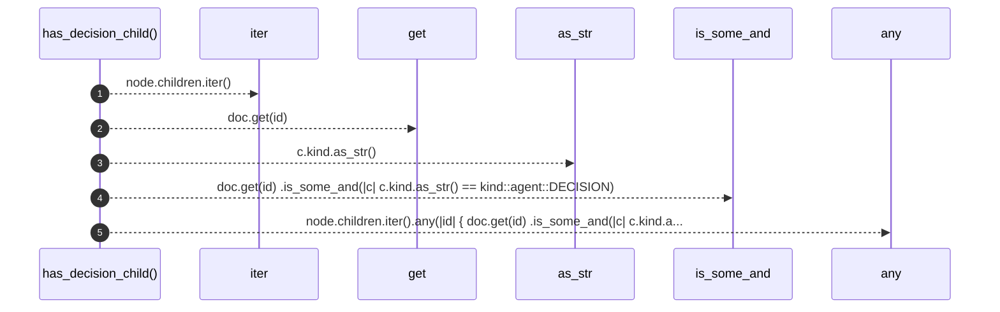

# `robby_agent::context::has_decision_child`

[Self-model](../../README.md) · [context](index.md)

| | |
|---|---|
| kind | `code.function` |
| signature | `fn has_decision_child(doc: &Document, node: &Node) -> bool` |
| location | [`crates/robby-agent/src/context.rs:69`](../../../../crates/robby-agent/src/context.rs#L69) |
| provenance | extractor · confidence 1.00 |

```rust
pub fn has_decision_child(doc: &Document, node: &Node) -> bool {
    node.children.iter().any(|id| {
        doc.get(id)
            .is_some_and(|c| c.kind.as_str() == kind::agent::DECISION)
    })
}
```



5 steps · 0 observed · 5 possible only

**Edges**

- calls → [`robby_ir::model::impl Document::get`](../../robby_ir/model/index.md)
- calls → [`robby_agent::model::impl Verdict::as_str`](../model/index.md)

## References

- calls → [`robby_agent::model`](../model/index.md) — as_str
- calls → [`robby_ir::model`](../../robby_ir/model/index.md) — get

## Referenced by

- calls ← [`robby_agent::context::collect_comment_contexts`](collect-comment-contexts.md)

