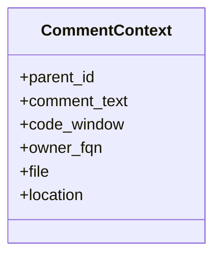
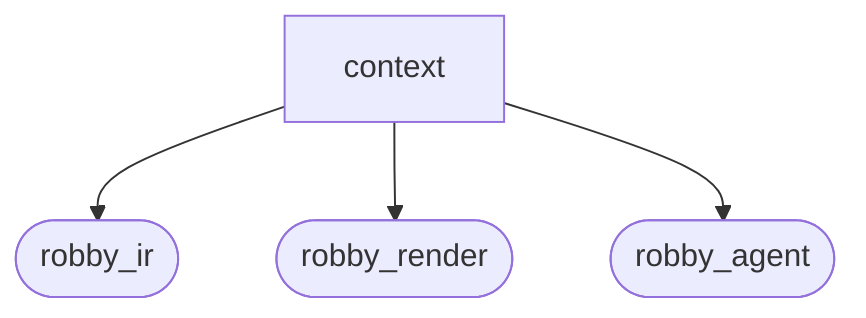
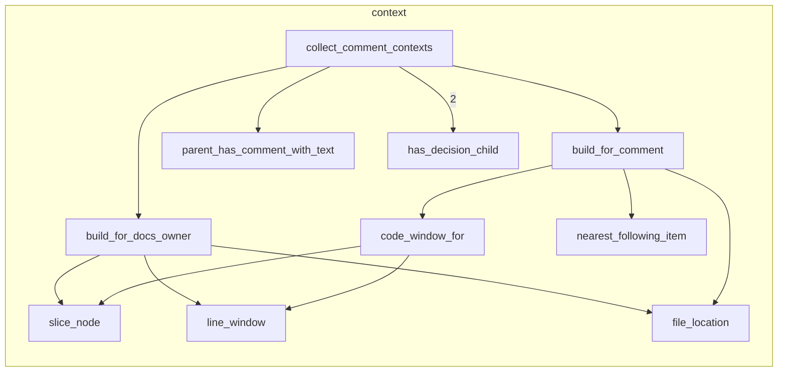

# `robby_agent::context`

[Self-model](../../README.md) · [robby_agent](../index.md)

| | |
|---|---|
| kind | `code.module` |
| declared at | [`crates/robby-agent/src/lib.rs:6`](../../../../crates/robby-agent/src/lib.rs#L6) |
| provenance | extractor · confidence 1.00 |
| nodes | 20 |

## Types



## Package diagram



## Module coupling



## Dependency matrix

| | context | robby_ir | robby_render | robby_agent |
|---|---:|---:|---:|---:|
| **context** | · | 20 | 3 | 3 |
| **robby_ir** | | · | | |
| **robby_render** | | | · | |
| **robby_agent** | | | | · |

## Comments

- `crates/robby-agent/src/context.rs:147:1` (docs, `robby_agent::context::nearest_following_item`): "Nearest following sibling item (not comment/import), by span start."
  ```
  /// Nearest following sibling item (not comment/import), by span start.
  pub(crate) fn nearest_following_item<'a>(doc: &'a Document, comment: &Node) -> Option<&'a Node> {
      let parent = comment.parent.as_ref().and_then(|id| doc.get(id))?;
      let comment_start = comment.span.as_ref()?.start.byte;
      let mut best: Option<(&Node, u32)> = None;
      for child_id in &parent.children {
          let Some(child) = doc.get(child_id) else {
              continue;
          };
          if matches!(
              child.kind.as_str(),
              kind::code::COMMENT | kind::code::IMPORT
          ) {
              continue;
          }
          let Some(span) = &child.span else {
              continue;
          };
          if span.start.byte < comment_start {
              continue;
          }
          match best {
              Some((_, byte)) if span.start.byte >= byte => {}
              _ => best = Some((child, span.start.byte)),
          }
      }
      best.map(|(n, _)| n)
  }
  ```
- `crates/robby-agent/src/context.rs:17:1` (docs, `robby_agent::context::collect_comment_contexts`): "Collect enrichable comment/docs contexts under the whole document."
  ```
  /// Collect enrichable comment/docs contexts under the whole document.
  pub fn collect_comment_contexts(
      doc: &Document,
      sources: &BTreeMap<String, String>,
  ) -> Vec<CommentContext> {
      let mut out = Vec::new();
  
      for node in doc.nodes.values() {
          if node.kind.as_str() == kind::code::COMMENT {
              let text = node.docs.clone().unwrap_or_default();
              if text.is_empty() {
                  continue;
              }
              if has_decision_child(doc, node) {
                  continue;
              }
              out.push(build_for_comment(doc, sources, node, text));
              continue;
          }
  
          // Docs-only: item docs with no covering comment node already enriched.
          let Some(docs) = &node.docs else {
              continue;
          };
          if docs.is_empty() || has_decision_child(doc, node) {
              continue;
          }
          if node.kind.as_str() == kind::code::COMMENT {
              continue;
          }
          // Skip if a comment node already carries the same text under the same parent.
          if parent_has_comment_with_text(doc, node, docs) {
              continue;
          }
          out.push(build_for_docs_owner(doc, sources, node, docs.clone()));
      }
  
      out.sort_by(|a, b| {
          (
              a.file.as_str(),
              a.location.as_deref().unwrap_or(""),
              a.parent_id.as_str(),
          )
              .cmp(&(
                  b.file.as_str(),
                  b.location.as_deref().unwrap_or(""),
                  b.parent_id.as_str(),
              ))
      });
      out
  }
  ```
- `crates/robby-agent/src/context.rs:184:1` (docs, `robby_agent::context::line_window`): "±20 lines around the node's span."
  ```
  /// ±20 lines around the node's span.
  fn line_window(sources: &BTreeMap<String, String>, node: &Node) -> Option<String> {
      let span = node.span.as_ref()?;
      let source = sources.get(&span.file)?;
      let start_line = span.start.line.saturating_sub(1) as usize;
      let end_line = span.end.line as usize;
      let from = start_line.saturating_sub(20);
      let to = (end_line + 20).min(source.lines().count().saturating_sub(1).max(end_line));
      let mut out = String::new();
      for (i, line) in source.lines().enumerate() {
          if i < from {
              continue;
          }
          if i > to {
              break;
          }
          out.push_str(line);
          out.push('\n');
      }
      if out.is_empty() { None } else { Some(out) }
  }
  ```
## References

- calls → [`robby_agent::enrich::tests`](../enrich/tests/index.md) — new
- calls → [`robby_ir::kind`](../../robby_ir/kind/index.md) — as_str
- calls → [`robby_ir::model`](../../robby_ir/model/index.md) — get
- calls → [`robby_ir::span`](../../robby_ir/span/index.md) — is_empty, location
- calls → [`robby_render::report`](../../robby_render/report/index.md) — push

## Referenced by

- calls ← [`robby_agent::enrich::enrich_comments`](../enrich/enrich-comments.md)

## Items

| Item | Kind | Steps | Location |
|---|---|---:|---|
| [`CommentContext`](commentcontext.md) | `code.struct` | — | `crates/robby-agent/src/context.rs:7:1` |
| [`collect_comment_contexts`](collect-comment-contexts.md) | `code.function` | 26 | `crates/robby-agent/src/context.rs:17:1` |
| [`has_decision_child`](has-decision-child.md) | `code.function` | 5 | `crates/robby-agent/src/context.rs:69:1` |
| [`parent_has_comment_with_text`](parent-has-comment-with-text.md) | `code.function` | 10 | `crates/robby-agent/src/context.rs:76:1` |
| [`build_for_comment`](build-for-comment.md) | `code.function` | 6 | `crates/robby-agent/src/context.rs:87:1` |
| [`build_for_docs_owner`](build-for-docs-owner.md) | `code.function` | 8 | `crates/robby-agent/src/context.rs:106:1` |
| [`file_location`](file-location.md) | `code.function` | 4 | `crates/robby-agent/src/context.rs:126:1` |
| [`code_window_for`](code-window-for.md) | `code.function` | 4 | `crates/robby-agent/src/context.rs:133:1` |
| [`nearest_following_item`](nearest-following-item.md) | `code.function` | 10 | `crates/robby-agent/src/context.rs:147:1` |
| [`slice_node`](slice-node.md) | `code.function` | 6 | `crates/robby-agent/src/context.rs:176:1` |
| [`line_window`](line-window.md) | `code.function` | 18 | `crates/robby-agent/src/context.rs:184:1` |

## Imports

- `use std::collections::BTreeMap;`
- [`use robby_ir::{Document, Node, NodeId, kind};`](../../robby_ir/index.md)

