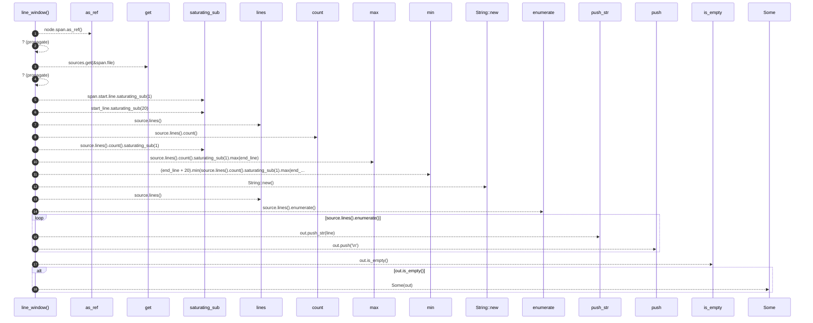

# `robby_agent::context::line_window`

[Self-model](../../README.md) · [context](index.md)

| | |
|---|---|
| kind | `code.function` |
| signature | `fn line_window(sources: &BTreeMap<String, String>, node: &Node) -> Option<String>` |
| location | [`crates/robby-agent/src/context.rs:184`](../../../../crates/robby-agent/src/context.rs#L184) |
| provenance | extractor · confidence 1.00 |

> ±20 lines around the node's span.

```rust
/// ±20 lines around the node's span.
fn line_window(sources: &BTreeMap<String, String>, node: &Node) -> Option<String> {
    let span = node.span.as_ref()?;
    let source = sources.get(&span.file)?;
    let start_line = span.start.line.saturating_sub(1) as usize;
    let end_line = span.end.line as usize;
    let from = start_line.saturating_sub(20);
    let to = (end_line + 20).min(source.lines().count().saturating_sub(1).max(end_line));
    let mut out = String::new();
    for (i, line) in source.lines().enumerate() {
        if i < from {
            continue;
        }
        if i > to {
            break;
        }
        out.push_str(line);
        out.push('\n');
    }
    if out.is_empty() { None } else { Some(out) }
}
```



18 steps · 0 observed · 18 possible only

**Edges**

- calls → [`robby_ir::model::impl Document::get`](../../robby_ir/model/index.md)
- calls → [`robby_agent::enrich::impl FakeClient::new`](../enrich/tests/index.md)
- calls → [`robby_render::report::impl Report::push`](../../robby_render/report/index.md)
- calls → [`robby_ir::span::impl Span::is_empty`](../../robby_ir/span/index.md)

## References

- calls → [`robby_agent::enrich::tests`](../enrich/tests/index.md) — new
- calls → [`robby_ir::model`](../../robby_ir/model/index.md) — get
- calls → [`robby_ir::span`](../../robby_ir/span/index.md) — is_empty
- calls → [`robby_render::report`](../../robby_render/report/index.md) — push

## Referenced by

- calls ← [`robby_agent::context::build_for_docs_owner`](build-for-docs-owner.md)
- calls ← [`robby_agent::context::code_window_for`](code-window-for.md)

