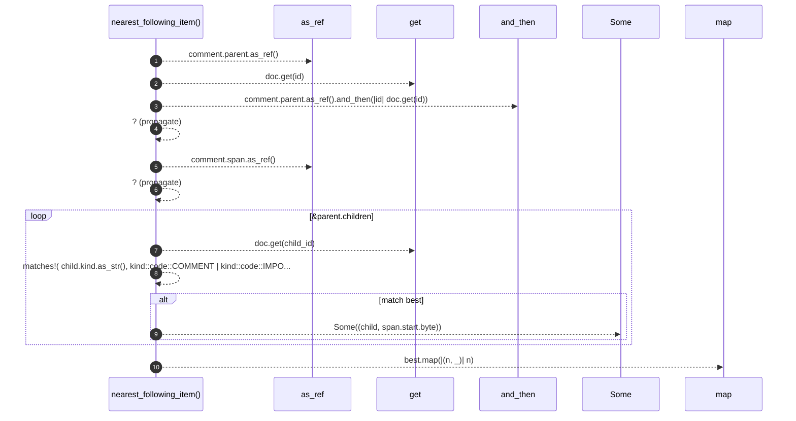

# `robby_agent::context::nearest_following_item`

[Self-model](../../README.md) · [context](index.md)

| | |
|---|---|
| kind | `code.function` |
| signature | `fn nearest_following_item<'a>(doc: &'a Document, comment: &Node) -> Option<&'a Node>` |
| location | [`crates/robby-agent/src/context.rs:147`](../../../../crates/robby-agent/src/context.rs#L147) |
| provenance | extractor · confidence 1.00 |

> Nearest following sibling item (not comment/import), by span start.

```rust
/// Nearest following sibling item (not comment/import), by span start.
pub(crate) fn nearest_following_item<'a>(doc: &'a Document, comment: &Node) -> Option<&'a Node> {
    let parent = comment.parent.as_ref().and_then(|id| doc.get(id))?;
    let comment_start = comment.span.as_ref()?.start.byte;
    let mut best: Option<(&Node, u32)> = None;
    for child_id in &parent.children {
        let Some(child) = doc.get(child_id) else {
            continue;
        };
        if matches!(
            child.kind.as_str(),
            kind::code::COMMENT | kind::code::IMPORT
        ) {
            continue;
        }
        let Some(span) = &child.span else {
            continue;
        };
        if span.start.byte < comment_start {
            continue;
        }
        match best {
            Some((_, byte)) if span.start.byte >= byte => {}
            _ => best = Some((child, span.start.byte)),
        }
    }
    best.map(|(n, _)| n)
}
```



10 steps · 0 observed · 10 possible only

**Edges**

- calls → [`robby_ir::run::RecipeCatalog::get`](../../robby_ir/run/index.md)
- calls → [`robby_ir::run::RecipeCatalog::get`](../../robby_ir/run/index.md)

## References

- calls → [`robby_ir::run`](../../robby_ir/run/index.md) — get

## Referenced by

- calls ← [`robby_agent::context::build_for_comment`](build-for-comment.md)

