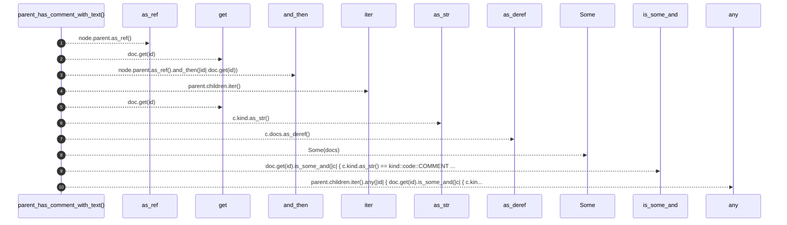

# `robby_agent::context::parent_has_comment_with_text`

[Self-model](../../README.md) · [context](index.md)

| | |
|---|---|
| kind | `code.function` |
| signature | `fn parent_has_comment_with_text(doc: &Document, node: &Node, docs: &str) -> bool` |
| location | [`crates/robby-agent/src/context.rs:76`](../../../../crates/robby-agent/src/context.rs#L76) |
| provenance | extractor · confidence 1.00 |

```rust
fn parent_has_comment_with_text(doc: &Document, node: &Node, docs: &str) -> bool {
    let Some(parent) = node.parent.as_ref().and_then(|id| doc.get(id)) else {
        return false;
    };
    parent.children.iter().any(|id| {
        doc.get(id).is_some_and(|c| {
            c.kind.as_str() == kind::code::COMMENT && c.docs.as_deref() == Some(docs)
        })
    })
}
```



10 steps · 0 observed · 10 possible only

**Edges**

- calls → [`robby_ir::model::impl Document::get`](../../robby_ir/model/index.md)
- calls → [`robby_ir::model::impl Document::get`](../../robby_ir/model/index.md)
- calls → [`robby_agent::model::impl Verdict::as_str`](../model/index.md)

## References

- calls → [`robby_agent::model`](../model/index.md) — as_str
- calls → [`robby_ir::model`](../../robby_ir/model/index.md) — get

## Referenced by

- calls ← [`robby_agent::context::collect_comment_contexts`](collect-comment-contexts.md)

