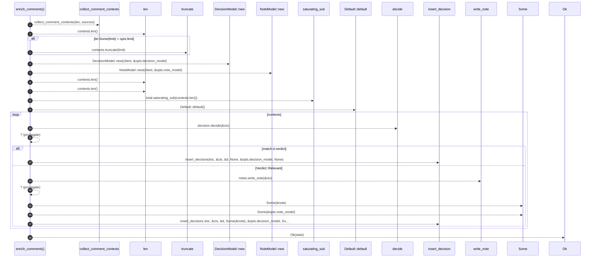

# `robby_agent::enrich::enrich_comments`

[Self-model](../../README.md) · [enrich](index.md)

| | |
|---|---|
| kind | `code.function` |
| signature | `fn enrich_comments(     doc: &mut Document,     sources: &BTreeMap<String, String>,     client: &dyn ChatClient,     opts: &EnrichOpts, ) -> Result<EnrichStats>` |
| location | [`crates/robby-agent/src/enrich.rs:43`](../../../../crates/robby-agent/src/enrich.rs#L43) |
| provenance | extractor · confidence 1.00 |

> Run two-stage enrich for comments lacking an `agent.decision` child.

```rust
/// Run two-stage enrich for comments lacking an `agent.decision` child.
pub fn enrich_comments(
    doc: &mut Document,
    sources: &BTreeMap<String, String>,
    client: &dyn ChatClient,
    opts: &EnrichOpts,
) -> Result<EnrichStats> {
    let mut contexts = collect_comment_contexts(doc, sources);
    let total = contexts.len();
    if let Some(limit) = opts.limit {
        contexts.truncate(limit);
    }

    let decision = DecisionModel::new(client, &opts.decision_model);
    let notes = NoteModel::new(client, &opts.note_model);

    let mut stats = EnrichStats {
        considered: contexts.len(),
        skipped_existing: total.saturating_sub(contexts.len()),
        ..Default::default()
    };

    // Collect contexts first so we don't hold borrows while mutating.
    for ctx in contexts {
        let d = decision.decide(&ctx)?;
        stats.decided += 1;
        match d.verdict {
            Verdict::Noise => {
                stats.noise += 1;
                insert_decision(doc, &ctx, &d, None, &opts.decision_model, None);
            }
            Verdict::Relevant => {
                stats.relevant += 1;
                let note = notes.write_note(&ctx)?;
                stats.noted += 1;
                insert_decision(
                    doc,
                    &ctx,
                    &d,
                    Some(&note),
                    &opts.decision_model,
                    Some(&opts.note_model),
                );
            }
        }
    }

    Ok(stats)
}
```



18 steps · 0 observed · 18 possible only

**Edges**

- calls → [`robby_agent::context::collect_comment_contexts`](../context/collect-comment-contexts.md)
- calls → [`robby_agent::enrich::impl FakeClient::new`](tests/index.md)
- calls → [`robby_agent::enrich::impl FakeClient::new`](tests/index.md)
- calls → [`robby_agent::enrich::impl Default for EnrichOpts::default`](index.md)
- calls → [`robby_agent::model::impl DecisionModel<'a, C>::decide`](../model/index.md)
- calls → [`robby_agent::enrich::insert_decision`](insert-decision.md)
- calls → [`robby_agent::model::impl NoteModel<'a, C>::write_note`](../model/index.md)
- calls → [`robby_agent::enrich::insert_decision`](insert-decision.md)

## References

- calls → [`robby_agent::context`](../context/index.md) — collect_comment_contexts
- calls → [`robby_agent::enrich`](index.md) — default, insert_decision
- calls → [`robby_agent::enrich::tests`](tests/index.md) — new
- calls → [`robby_agent::model`](../model/index.md) — decide, write_note

## Referenced by

- calls ← [`robby_agent::enrich::idempotent_skip_when_decision_exists`](tests/idempotent-skip-when-decision-exists.md)
- calls ← [`robby_agent::enrich::noise_short_circuits_without_note_call`](tests/noise-short-circuits-without-note-call.md)
- calls ← [`robby_agent::enrich::relevant_writes_note_and_highlights`](tests/relevant-writes-note-and-highlights.md)

