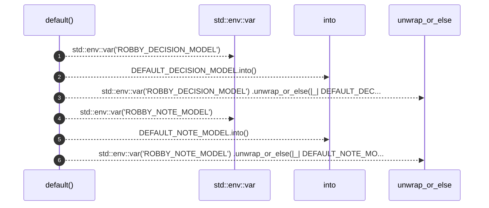

# `robby_agent::enrich::impl Default for EnrichOpts`

[Self-model](../../README.md) · [enrich](index.md)

| | |
|---|---|
| kind | `code.impl` |
| location | [`crates/robby-agent/src/enrich.rs:21`](../../../../crates/robby-agent/src/enrich.rs#L21) |
| provenance | extractor · confidence 1.00 |

```rust
impl Default for EnrichOpts {
    fn default() -> Self {
        Self {
            decision_model: std::env::var("ROBBY_DECISION_MODEL")
                .unwrap_or_else(|_| DEFAULT_DECISION_MODEL.into()),
            note_model: std::env::var("ROBBY_NOTE_MODEL")
                .unwrap_or_else(|_| DEFAULT_NOTE_MODEL.into()),
            limit: None,
        }
    }
}
```

## Referenced by

- calls ← [`robby_agent::enrich::enrich_comments`](enrich-comments.md)
- calls ← [`robby_agent::enrich::idempotent_skip_when_decision_exists`](tests/idempotent-skip-when-decision-exists.md)
- calls ← [`robby_agent::enrich::noise_short_circuits_without_note_call`](tests/noise-short-circuits-without-note-call.md)
- calls ← [`robby_agent::enrich::relevant_writes_note_and_highlights`](tests/relevant-writes-note-and-highlights.md)

### `default`

| | |
|---|---|
| kind | `code.method` |
| signature | `fn default(0)` |
| location | [`crates/robby-agent/src/enrich.rs:22`](../../../../crates/robby-agent/src/enrich.rs#L22) |
| provenance | extractor · confidence 1.00 |

```rust
fn default() -> Self {
        Self {
            decision_model: std::env::var("ROBBY_DECISION_MODEL")
                .unwrap_or_else(|_| DEFAULT_DECISION_MODEL.into()),
            note_model: std::env::var("ROBBY_NOTE_MODEL")
                .unwrap_or_else(|_| DEFAULT_NOTE_MODEL.into()),
            limit: None,
        }
    }
```



6 steps · 0 observed · 6 possible only

