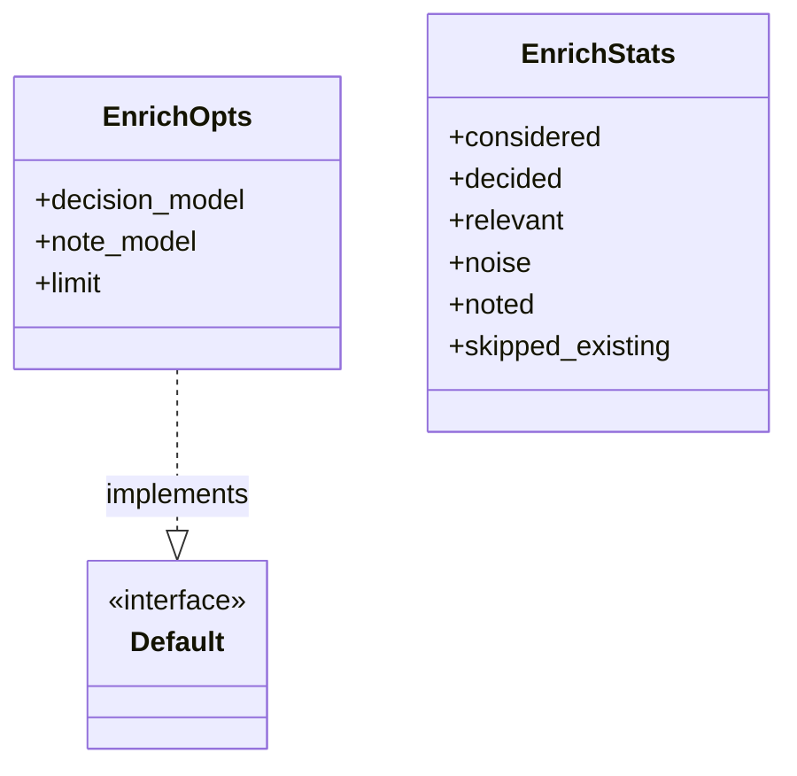
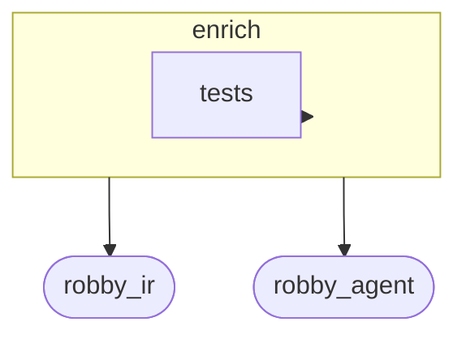
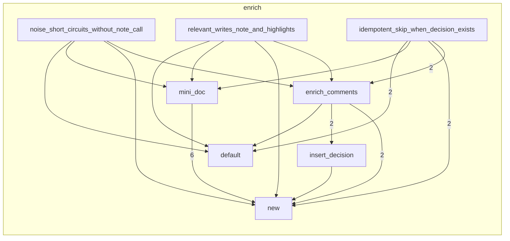

# `robby_agent::enrich`

[Self-model](../../README.md) · [robby_agent](../index.md)

| | |
|---|---|
| kind | `code.module` |
| declared at | [`crates/robby-agent/src/lib.rs:7`](../../../../crates/robby-agent/src/lib.rs#L7) |
| provenance | extractor · confidence 1.00 |
| nodes | 36 |

## Types



## Package diagram



## Module coupling



## Dependency matrix

| | enrich | tests | robby_ir | robby_agent |
|---|---:|---:|---:|---:|
| **enrich** | · | 17 | 26 | 8 |
| **tests** | | · | | |
| **robby_ir** | | | · | |
| **robby_agent** | | | | · |

## Comments

- `crates/robby-agent/src/enrich.rs:43:1` (docs, `robby_agent::enrich::enrich_comments`): "Run two-stage enrich for comments lacking an `agent.decision` child."
  ```
  /// Run two-stage enrich for comments lacking an `agent.decision` child.
  pub fn enrich_comments(
      doc: &mut Document,
      sources: &BTreeMap<String, String>,
      client: &dyn ChatClient,
      opts: &EnrichOpts,
  ) -> Result<EnrichStats> {
      let mut contexts = collect_comment_contexts(doc, sources);
      let total = contexts.len();
      if let Some(limit) = opts.limit {
          contexts.truncate(limit);
      }
  
      let decision = DecisionModel::new(client, &opts.decision_model);
      let notes = NoteModel::new(client, &opts.note_model);
  
      let mut stats = EnrichStats {
          considered: contexts.len(),
          skipped_existing: total.saturating_sub(contexts.len()),
          ..Default::default()
      };
  
      // Collect contexts first so we don't hold borrows while mutating.
      for ctx in contexts {
          let d = decision.decide(&ctx)?;
          stats.decided += 1;
          match d.verdict {
              Verdict::Noise => {
                  stats.noise += 1;
                  insert_decision(doc, &ctx, &d, None, &opts.decision_model, None);
              }
              Verdict::Relevant => {
                  stats.relevant += 1;
                  let note = notes.write_note(&ctx)?;
                  stats.noted += 1;
                  insert_decision(
                      doc,
                      &ctx,
                      &d,
                      Some(&note),
                      &opts.decision_model,
                      Some(&opts.note_model),
                  );
              }
          }
      }
  
      Ok(stats)
  }
  ```
## References

- calls → [`robby_agent::context`](../context/index.md) — collect_comment_contexts
- calls → [`robby_agent::model`](../model/index.md) — as_str, decide, write_note
- calls → [`robby_ir::model`](../../robby_ir/model/index.md) — 5 items
- calls → [`robby_ir::span`](../../robby_ir/span/index.md) — is_empty

## Referenced by

- calls ← [`robby_agent::context::collect_comment_contexts`](../context/collect-comment-contexts.md)
- calls ← [`robby_agent::context::file_location`](../context/file-location.md)
- calls ← [`robby_agent::context::line_window`](../context/line-window.md)

## Modules

- [`enrich::tests`](tests/index.md) — 15 nodes

## Items

| Item | Kind | Steps | Location |
|---|---|---:|---|
| [`EnrichOpts`](enrichopts.md) | `code.struct` | — | `crates/robby-agent/src/enrich.rs:13:1` |
| [`impl Default for EnrichOpts`](impl-default-for-enrichopts.md) | `code.impl` | — | `crates/robby-agent/src/enrich.rs:21:1` |
| [`EnrichStats`](enrichstats.md) | `code.struct` | — | `crates/robby-agent/src/enrich.rs:33:1` |
| [`enrich_comments`](enrich-comments.md) | `code.function` | 18 | `crates/robby-agent/src/enrich.rs:43:1` |
| [`insert_decision`](insert-decision.md) | `code.function` | 36 | `crates/robby-agent/src/enrich.rs:93:1` |

## Imports

- `use std::collections::BTreeMap;`
- `use anyhow::Result;`
- [`use robby_ir::{Document, Lang, Node, NodeId, Provenance, Source, kind};`](../../robby_ir/index.md)
- `use crate::context::{CommentContext, collect_comment_contexts};`
- `use crate::model::{`

