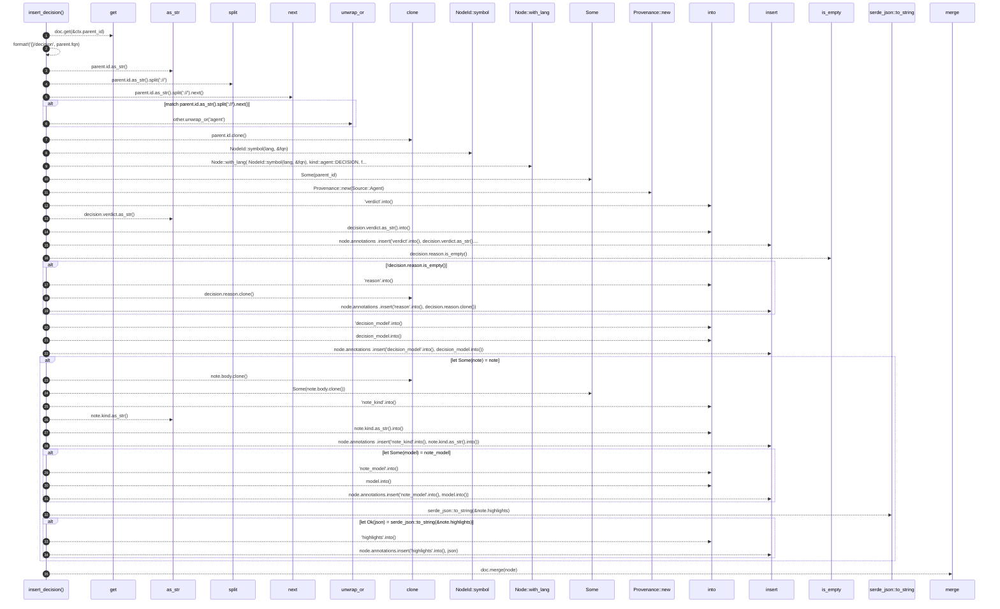

# `robby_agent::enrich::insert_decision`

[Self-model](../../README.md) · [enrich](index.md)

| | |
|---|---|
| kind | `code.function` |
| signature | `fn insert_decision(     doc: &mut Document,     ctx: &CommentContext,     decision: &crate::model::Decision,     note: Option<&crate::model::Note>,     decision_model: &str,     note_model: Option<&str>, )` |
| location | [`crates/robby-agent/src/enrich.rs:93`](../../../../crates/robby-agent/src/enrich.rs#L93) |
| provenance | extractor · confidence 1.00 |

```rust
fn insert_decision(
    doc: &mut Document,
    ctx: &CommentContext,
    decision: &crate::model::Decision,
    note: Option<&crate::model::Note>,
    decision_model: &str,
    note_model: Option<&str>,
) {
    let Some(parent) = doc.get(&ctx.parent_id) else {
        return;
    };
    let fqn = format!("{}/decision", parent.fqn);
    let lang = match parent.id.as_str().split("://").next() {
        Some("typescript") => "typescript",
        Some("rust") => "rust",
        other => other.unwrap_or("agent"),
    };
    let parent_lang = parent.lang;
    let parent_id = parent.id.clone();

    let mut node = Node::with_lang(
        NodeId::symbol(lang, &fqn),
        kind::agent::DECISION,
        fqn,
        match parent_lang {
            Lang::TypeScript => Lang::TypeScript,
            Lang::Rust => Lang::Rust,
            Lang::Unknown => Lang::Unknown,
        },
    );
    node.parent = Some(parent_id);
    node.provenance = Provenance::new(Source::Agent);
    node.annotations
        .insert("verdict".into(), decision.verdict.as_str().into());
    if !decision.reason.is_empty() {
        node.annotations
            .insert("reason".into(), decision.reason.clone());
    }
    node.annotations
        .insert("decision_model".into(), decision_model.into());

    if let Some(note) = note {
        node.docs = Some(note.body.clone());
        node.annotations
            .insert("note_kind".into(), note.kind.as_str().into());
        if let Some(model) = note_model {
            node.annotations.insert("note_model".into(), model.into());
        }
        if let Ok(json) = serde_json::to_string(&note.highlights) {
            node.annotations.insert("highlights".into(), json);
        }
    }

    doc.merge(node);
}
```



35 steps · 0 observed · 35 possible only

**Edges**

- calls → [`robby_ir::model::impl Document::get`](../../robby_ir/model/index.md)
- calls → [`robby_ir::kind::impl Kind::as_str`](../../robby_ir/kind/index.md)
- calls → [`robby_ir::model::impl NodeId::symbol`](../../robby_ir/model/index.md)
- calls → [`robby_ir::model::impl Node::with_lang`](../../robby_ir/model/index.md)
- calls → [`robby_agent::enrich::impl FakeClient::new`](tests/index.md)
- calls → [`robby_ir::kind::impl Kind::as_str`](../../robby_ir/kind/index.md)
- calls → [`robby_ir::model::impl Document::insert`](../../robby_ir/model/index.md)
- calls → [`robby_ir::span::impl Span::is_empty`](../../robby_ir/span/index.md)
- calls → [`robby_ir::model::impl Document::insert`](../../robby_ir/model/index.md)
- calls → [`robby_ir::model::impl Document::insert`](../../robby_ir/model/index.md)
- calls → [`robby_ir::kind::impl Kind::as_str`](../../robby_ir/kind/index.md)
- calls → [`robby_ir::model::impl Document::insert`](../../robby_ir/model/index.md)
- calls → [`robby_ir::model::impl Document::insert`](../../robby_ir/model/index.md)
- calls → [`robby_ir::model::impl Document::insert`](../../robby_ir/model/index.md)
- calls → [`robby_ir::model::impl Document::merge`](../../robby_ir/model/index.md)

## References

- calls → [`robby_agent::enrich::tests`](tests/index.md) — new
- calls → [`robby_ir::kind`](../../robby_ir/kind/index.md) — as_str
- calls → [`robby_ir::model`](../../robby_ir/model/index.md) — 5 items
- calls → [`robby_ir::span`](../../robby_ir/span/index.md) — is_empty

## Referenced by

- calls ← [`robby_agent::enrich::enrich_comments`](enrich-comments.md)

