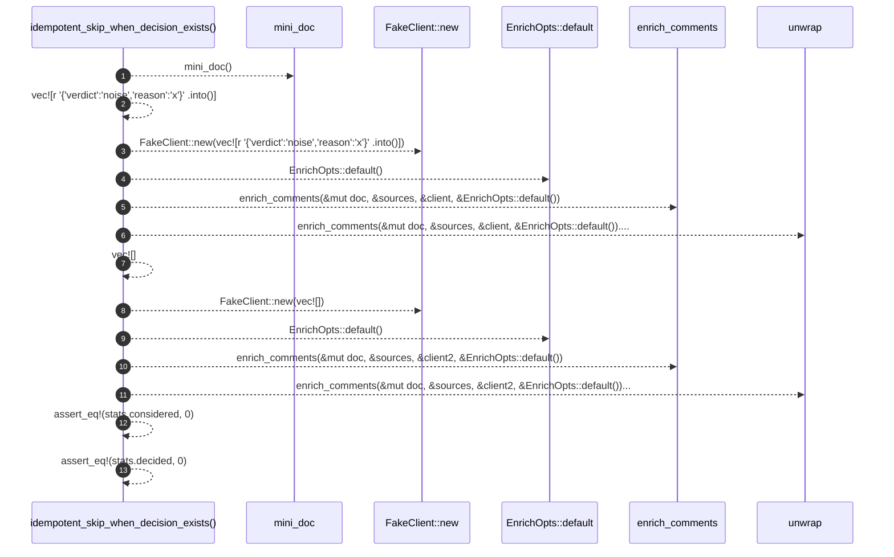

# `robby_agent::enrich::idempotent_skip_when_decision_exists`

[Self-model](../../../README.md) · [enrich::tests](index.md)

| | |
|---|---|
| kind | `code.function` |
| signature | `fn idempotent_skip_when_decision_exists()` |
| location | [`crates/robby-agent/src/enrich.rs:286`](../../../../../crates/robby-agent/src/enrich.rs#L286) |
| provenance | extractor · confidence 1.00 |

```rust
#[test]
    fn idempotent_skip_when_decision_exists() {
        let (mut doc, sources) = mini_doc();
        let client = FakeClient::new(vec![r#"{"verdict":"noise","reason":"x"}"#.into()]);
        enrich_comments(&mut doc, &sources, &client, &EnrichOpts::default()).unwrap();
        let client2 = FakeClient::new(vec![]);
        let stats = enrich_comments(&mut doc, &sources, &client2, &EnrichOpts::default()).unwrap();
        assert_eq!(stats.considered, 0);
        assert_eq!(stats.decided, 0);
    }
```



13 steps · 0 observed · 13 possible only

**Edges**

- calls → [`robby_agent::enrich::mini_doc`](mini-doc.md)
- calls → [`robby_agent::enrich::impl FakeClient::new`](index.md)
- calls → [`robby_agent::enrich::impl Default for EnrichOpts::default`](../index.md)
- calls → [`robby_agent::enrich::enrich_comments`](../enrich-comments.md)
- calls → [`robby_agent::enrich::impl FakeClient::new`](index.md)
- calls → [`robby_agent::enrich::impl Default for EnrichOpts::default`](../index.md)
- calls → [`robby_agent::enrich::enrich_comments`](../enrich-comments.md)

## References

- calls → [`robby_agent::enrich`](../index.md) — default, enrich_comments
- calls → [`robby_agent::enrich::tests`](index.md) — mini_doc, new

