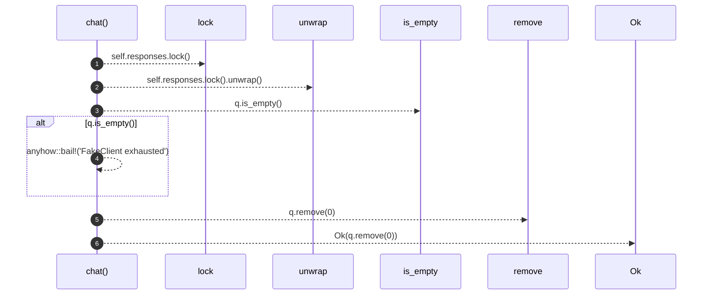

# `robby_agent::enrich::impl ChatClient for FakeClient`

[Self-model](../../../README.md) · [enrich::tests](index.md)

| | |
|---|---|
| kind | `code.impl` |
| location | [`crates/robby-agent/src/enrich.rs:170`](../../../../../crates/robby-agent/src/enrich.rs#L170) |
| provenance | extractor · confidence 1.00 |

```rust
impl ChatClient for FakeClient {
        fn chat(&self, _model: &str, _messages: &[ChatMessage], _json_mode: bool) -> Result<String> {
            let mut q = self.responses.lock().unwrap();
            if q.is_empty() {
                anyhow::bail!("FakeClient exhausted");
            }
            Ok(q.remove(0))
        }
    }
```

## References

- calls → [`robby_ir::span`](../../../robby_ir/span/index.md) — is_empty

### `chat`

| | |
|---|---|
| kind | `code.method` |
| signature | `fn chat(4)` |
| location | [`crates/robby-agent/src/enrich.rs:171`](../../../../../crates/robby-agent/src/enrich.rs#L171) |
| provenance | extractor · confidence 1.00 |

```rust
fn chat(&self, _model: &str, _messages: &[ChatMessage], _json_mode: bool) -> Result<String> {
            let mut q = self.responses.lock().unwrap();
            if q.is_empty() {
                anyhow::bail!("FakeClient exhausted");
            }
            Ok(q.remove(0))
        }
```



6 steps · 0 observed · 6 possible only

**Edges**

- calls → [`robby_ir::span::impl Span::is_empty`](../../../robby_ir/span/index.md)

