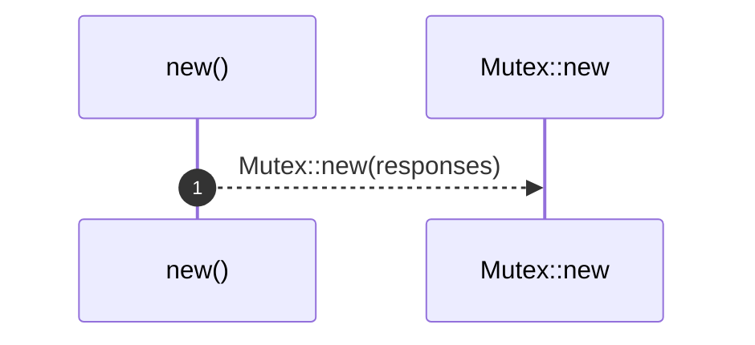

# `robby_agent::enrich::impl FakeClient`

[Self-model](../../../README.md) · [enrich::tests](index.md)

| | |
|---|---|
| kind | `code.impl` |
| location | [`crates/robby-agent/src/enrich.rs:160`](../../../../../crates/robby-agent/src/enrich.rs#L160) |
| provenance | extractor · confidence 1.00 |

```rust
impl FakeClient {
        fn new(responses: Vec<String>) -> Self {
            Self {
                responses: Mutex::new(responses),
            }
        }
    }
```

## Referenced by

- calls ← [`robby_agent::context::collect_comment_contexts`](../../context/collect-comment-contexts.md)
- calls ← [`robby_agent::context::file_location`](../../context/file-location.md)
- calls ← [`robby_agent::context::line_window`](../../context/line-window.md)
- calls ← [`robby_agent::enrich::enrich_comments`](../enrich-comments.md)
- calls ← [`robby_agent::enrich::idempotent_skip_when_decision_exists`](idempotent-skip-when-decision-exists.md)
- calls ← [`robby_agent::enrich::insert_decision`](../insert-decision.md)
- calls ← [`robby_agent::enrich::mini_doc`](mini-doc.md)
- calls ← [`robby_agent::enrich::noise_short_circuits_without_note_call`](noise-short-circuits-without-note-call.md)
- calls ← [`robby_agent::enrich::relevant_writes_note_and_highlights`](relevant-writes-note-and-highlights.md)

### `new`

| | |
|---|---|
| kind | `code.method` |
| signature | `fn new(1)` |
| location | [`crates/robby-agent/src/enrich.rs:161`](../../../../../crates/robby-agent/src/enrich.rs#L161) |
| provenance | extractor · confidence 1.00 |

```rust
fn new(responses: Vec<String>) -> Self {
            Self {
                responses: Mutex::new(responses),
            }
        }
```



1 steps · 0 observed · 1 possible only

**Edges**

- calls → [`robby_agent::enrich::impl FakeClient::new`](index.md)

