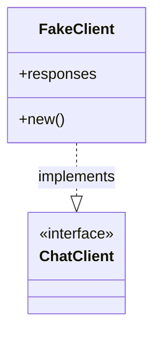
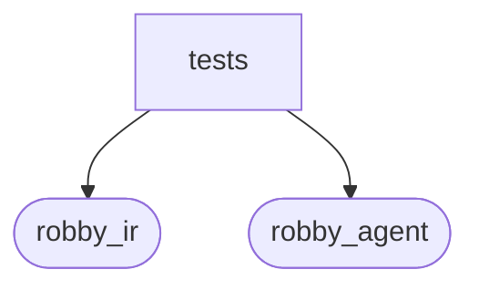

# `robby_agent::enrich::tests`

[Self-model](../../../README.md) · [enrich](../index.md)

| | |
|---|---|
| kind | `code.module` |
| declared at | [`crates/robby-agent/src/enrich.rs:149`](../../../../../crates/robby-agent/src/enrich.rs#L149) |
| provenance | extractor · confidence 1.00 |
| nodes | 15 |

## Types

## Package diagram

## Dependency matrix

| | tests | robby_ir | robby_agent |
|---|---:|---:|---:|
| **tests** | · | 16 | 8 |
| **robby_ir** | | · | |
| **robby_agent** | | | · |
## References

- calls → [`robby_agent::enrich`](../index.md) — default, enrich_comments
- calls → [`robby_ir::kind`](../../../robby_ir/kind/index.md) — as_str
- calls → [`robby_ir::model`](../../../robby_ir/model/index.md) — insert, symbol, with_lang
- calls → [`robby_ir::span`](../../../robby_ir/span/index.md) — is_empty

## Referenced by

- calls ← [`robby_agent::context::collect_comment_contexts`](../../context/collect-comment-contexts.md)
- calls ← [`robby_agent::context::file_location`](../../context/file-location.md)
- calls ← [`robby_agent::context::line_window`](../../context/line-window.md)
- calls ← [`robby_agent::enrich::enrich_comments`](../enrich-comments.md)
- calls ← [`robby_agent::enrich::insert_decision`](../insert-decision.md)

## Items

| Item | Kind | Steps | Location |
|---|---|---:|---|
| [`FakeClient`](fakeclient.md) | `code.struct` | — | `crates/robby-agent/src/enrich.rs:156:5` |
| [`impl FakeClient`](impl-fakeclient.md) | `code.impl` | — | `crates/robby-agent/src/enrich.rs:160:5` |
| [`impl ChatClient for FakeClient`](impl-chatclient-for-fakeclient.md) | `code.impl` | — | `crates/robby-agent/src/enrich.rs:168:5` |
| [`mini_doc`](mini-doc.md) | `code.function` | 31 | `crates/robby-agent/src/enrich.rs:183:5` |
| [`noise_short_circuits_without_note_call`](noise-short-circuits-without-note-call.md) | `code.function` | 14 | `crates/robby-agent/src/enrich.rs:233:5` |
| [`relevant_writes_note_and_highlights`](relevant-writes-note-and-highlights.md) | `code.function` | 15 | `crates/robby-agent/src/enrich.rs:255:5` |
| [`idempotent_skip_when_decision_exists`](idempotent-skip-when-decision-exists.md) | `code.function` | 13 | `crates/robby-agent/src/enrich.rs:286:5` |

## Imports

- `use super::*;`
- `use crate::model::{ChatClient, ChatMessage};`
- [`use robby_ir::{Position, Span};`](../../../robby_ir/index.md)
- `use std::sync::Mutex;`

