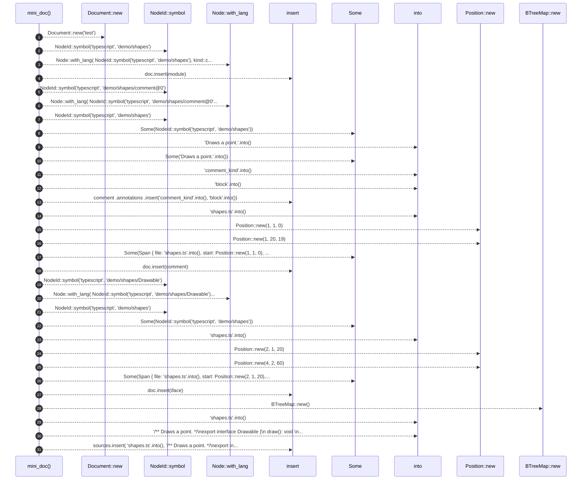

# `robby_agent::enrich::mini_doc`

[Self-model](../../../README.md) · [enrich::tests](index.md)

| | |
|---|---|
| kind | `code.function` |
| signature | `fn mini_doc() -> (Document, BTreeMap<String, String>)` |
| location | [`crates/robby-agent/src/enrich.rs:183`](../../../../../crates/robby-agent/src/enrich.rs#L183) |
| provenance | extractor · confidence 1.00 |

```rust
fn mini_doc() -> (Document, BTreeMap<String, String>) {
        let mut doc = Document::new("test");
        let module = Node::with_lang(
            NodeId::symbol("typescript", "demo/shapes"),
            kind::code::MODULE,
            "demo/shapes",
            Lang::TypeScript,
        );
        doc.insert(module);

        let mut comment = Node::with_lang(
            NodeId::symbol("typescript", "demo/shapes/comment@0"),
            kind::code::COMMENT,
            "demo/shapes/comment@0",
            Lang::TypeScript,
        );
        comment.parent = Some(NodeId::symbol("typescript", "demo/shapes"));
        comment.docs = Some("Draws a point.".into());
        comment
            .annotations
            .insert("comment_kind".into(), "block".into());
        comment.span = Some(Span {
            file: "shapes.ts".into(),
            start: Position::new(1, 1, 0),
            end: Position::new(1, 20, 19),
        });
        doc.insert(comment);

        let mut iface = Node::with_lang(
            NodeId::symbol("typescript", "demo/shapes/Drawable"),
            kind::code::INTERFACE,
            "demo/shapes/Drawable",
            Lang::TypeScript,
        );
        iface.parent = Some(NodeId::symbol("typescript", "demo/shapes"));
        iface.span = Some(Span {
            file: "shapes.ts".into(),
            start: Position::new(2, 1, 20),
            end: Position::new(4, 2, 60),
        });
        doc.insert(iface);

        let mut sources = BTreeMap::new();
        sources.insert(
            "shapes.ts".into(),
            "/** Draws a point. */\nexport interface Drawable {\n  draw(): void;\n}\n".into(),
        );
        (doc, sources)
    }
```



31 steps · 0 observed · 31 possible only

**Edges**

- calls → [`robby_agent::enrich::impl FakeClient::new`](index.md)
- calls → [`robby_ir::model::impl NodeId::symbol`](../../../robby_ir/model/index.md)
- calls → [`robby_ir::model::impl Node::with_lang`](../../../robby_ir/model/index.md)
- calls → [`robby_ir::model::impl Document::insert`](../../../robby_ir/model/index.md)
- calls → [`robby_ir::model::impl NodeId::symbol`](../../../robby_ir/model/index.md)
- calls → [`robby_ir::model::impl Node::with_lang`](../../../robby_ir/model/index.md)
- calls → [`robby_ir::model::impl NodeId::symbol`](../../../robby_ir/model/index.md)
- calls → [`robby_ir::model::impl Document::insert`](../../../robby_ir/model/index.md)
- calls → [`robby_agent::enrich::impl FakeClient::new`](index.md)
- calls → [`robby_agent::enrich::impl FakeClient::new`](index.md)
- calls → [`robby_ir::model::impl Document::insert`](../../../robby_ir/model/index.md)
- calls → [`robby_ir::model::impl NodeId::symbol`](../../../robby_ir/model/index.md)
- calls → [`robby_ir::model::impl Node::with_lang`](../../../robby_ir/model/index.md)
- calls → [`robby_ir::model::impl NodeId::symbol`](../../../robby_ir/model/index.md)
- calls → [`robby_agent::enrich::impl FakeClient::new`](index.md)
- calls → [`robby_agent::enrich::impl FakeClient::new`](index.md)
- calls → [`robby_ir::model::impl Document::insert`](../../../robby_ir/model/index.md)
- calls → [`robby_agent::enrich::impl FakeClient::new`](index.md)
- calls → [`robby_ir::model::impl Document::insert`](../../../robby_ir/model/index.md)

## References

- calls → [`robby_agent::enrich::tests`](index.md) — new
- calls → [`robby_ir::model`](../../../robby_ir/model/index.md) — insert, symbol, with_lang

## Referenced by

- calls ← [`robby_agent::enrich::idempotent_skip_when_decision_exists`](idempotent-skip-when-decision-exists.md)
- calls ← [`robby_agent::enrich::noise_short_circuits_without_note_call`](noise-short-circuits-without-note-call.md)
- calls ← [`robby_agent::enrich::relevant_writes_note_and_highlights`](relevant-writes-note-and-highlights.md)

