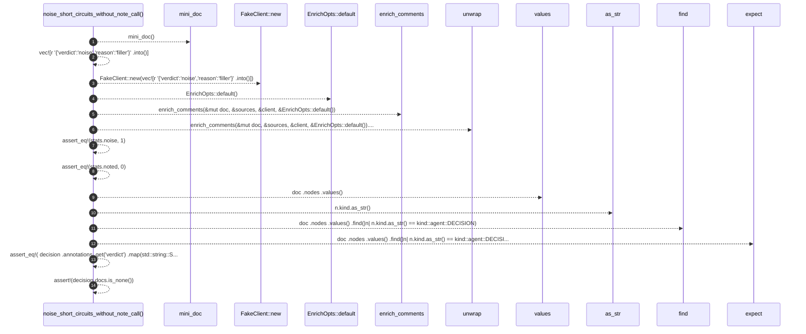

# `robby_agent::enrich::noise_short_circuits_without_note_call`

[Self-model](../../../README.md) · [enrich::tests](index.md)

| | |
|---|---|
| kind | `code.function` |
| signature | `fn noise_short_circuits_without_note_call()` |
| location | [`crates/robby-agent/src/enrich.rs:233`](../../../../../crates/robby-agent/src/enrich.rs#L233) |
| provenance | extractor · confidence 1.00 |

```rust
#[test]
    fn noise_short_circuits_without_note_call() {
        let (mut doc, sources) = mini_doc();
        let client = FakeClient::new(vec![r#"{"verdict":"noise","reason":"filler"}"#.into()]);
        let stats = enrich_comments(&mut doc, &sources, &client, &EnrichOpts::default()).unwrap();
        assert_eq!(stats.noise, 1);
        assert_eq!(stats.noted, 0);
        let decision = doc
            .nodes
            .values()
            .find(|n| n.kind.as_str() == kind::agent::DECISION)
            .expect("decision");
        assert_eq!(
            decision
                .annotations
                .get("verdict")
                .map(std::string::String::as_str),
            Some("noise")
        );
        assert!(decision.docs.is_none());
    }
```



14 steps · 0 observed · 14 possible only

**Edges**

- calls → [`robby_agent::enrich::mini_doc`](mini-doc.md)
- calls → [`robby_agent::enrich::impl FakeClient::new`](index.md)
- calls → [`robby_agent::enrich::impl Default for EnrichOpts::default`](../index.md)
- calls → [`robby_agent::enrich::enrich_comments`](../enrich-comments.md)
- calls → [`robby_ir::kind::impl Kind::as_str`](../../../robby_ir/kind/index.md)

## References

- calls → [`robby_agent::enrich`](../index.md) — default, enrich_comments
- calls → [`robby_agent::enrich::tests`](index.md) — mini_doc, new
- calls → [`robby_ir::kind`](../../../robby_ir/kind/index.md) — as_str

