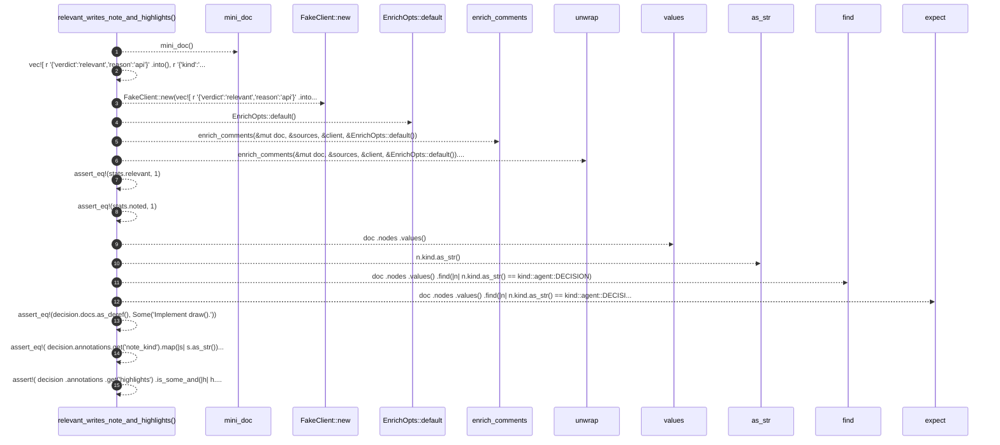

# `robby_agent::enrich::relevant_writes_note_and_highlights`

[Self-model](../../../README.md) · [enrich::tests](index.md)

| | |
|---|---|
| kind | `code.function` |
| signature | `fn relevant_writes_note_and_highlights()` |
| location | [`crates/robby-agent/src/enrich.rs:259`](../../../../../crates/robby-agent/src/enrich.rs#L259) |
| provenance | extractor · confidence 1.00 |

```rust
#[test]
    fn relevant_writes_note_and_highlights() {
        let (mut doc, sources) = mini_doc();
        let client = FakeClient::new(vec![
            r#"{"verdict":"relevant","reason":"api"}"#.into(),
            r#"{"kind":"usage_example","body":"Implement draw().","highlights":[{"start":0,"end":6}]}"#.into(),
        ]);
        let stats = enrich_comments(&mut doc, &sources, &client, &EnrichOpts::default()).unwrap();
        assert_eq!(stats.relevant, 1);
        assert_eq!(stats.noted, 1);
        let decision = doc
            .nodes
            .values()
            .find(|n| n.kind.as_str() == kind::agent::DECISION)
            .expect("decision");
        assert_eq!(decision.docs.as_deref(), Some("Implement draw()."));
        assert_eq!(
            decision.annotations.get("note_kind").map(|s| s.as_str()),
            Some("usage_example")
        );
        assert!(
            decision
                .annotations
                .get("highlights")
                .is_some_and(|h| h.contains("\"start\":0"))
        );
    }
```



15 steps · 0 observed · 15 possible only

**Edges**

- calls → [`robby_agent::enrich::mini_doc`](mini-doc.md)
- calls → [`robby_agent::enrich::impl FakeClient::new`](index.md)
- calls → [`robby_agent::enrich::impl Default for EnrichOpts::default`](../index.md)
- calls → [`robby_agent::enrich::enrich_comments`](../enrich-comments.md)
- calls → [`robby_agent::model::impl Verdict::as_str`](../../model/index.md)

## References

- calls → [`robby_agent::enrich`](../index.md) — default, enrich_comments
- calls → [`robby_agent::enrich::tests`](index.md) — mini_doc, new
- calls → [`robby_agent::model`](../../model/index.md) — as_str

