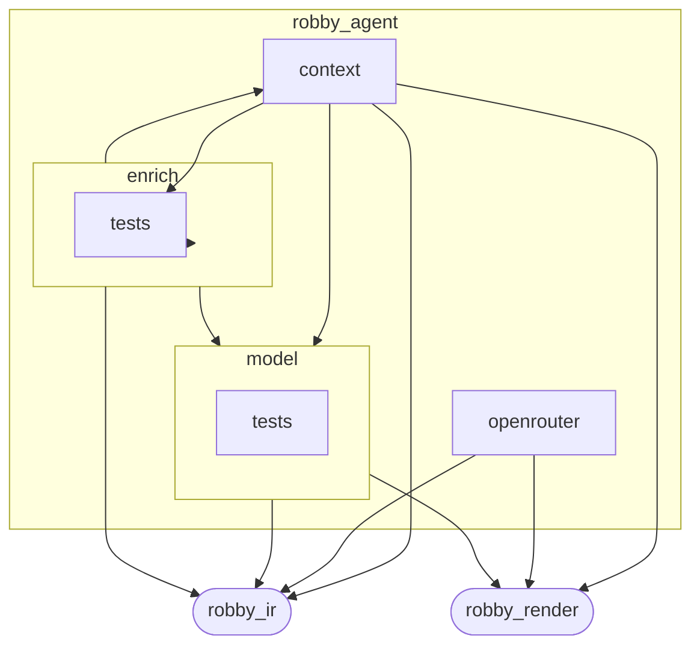

# `robby_agent`

[Self-model](../README.md)

| | |
|---|---|
| kind | `code.crate` |
| provenance | extractor · confidence 1.00 |
| nodes | 142 |

## Package diagram



## Module coupling

```mermaid
flowchart TB
    subgraph n_f3e9f97d91a4f4af["robby_agent"]
        direction TB
        subgraph n_8ece825e5a096dd6["context"]
            direction TB
            n_bc7398dbf6481d10["build_for_comment"]
            n_06a3c84c55d2315c["build_for_docs_owner"]
            n_61bd98d44e636f64["code_window_for"]
            n_1dc04536ee84305f["collect_comment_contexts"]
            n_bf449c22aab0cac2["file_location"]
            n_c1f9e59730490224["has_decision_child"]
            n_1dc5482c6035715d["line_window"]
            n_1e232fac7e629f3a["nearest_following_item"]
            n_ac63655d2a29ac8a["parent_has_comment_with_text"]
            n_0c9bed56e6eb7735["slice_node"]
        end
        subgraph n_fcd74fcd7fa20296["enrich"]
            direction TB
            n_6afbb71d759f3316["default"]
            n_fc6e94c13c15442e["enrich_comments"]
            n_f44edd6b2eb226ea["idempotent_skip_when_decision_exists"]
            n_df84fdce0689b5ca["insert_decision"]
            n_777e907af8a70400["mini_doc"]
            n_ef8fad1e9c264788["new"]
            n_a1cd648afdfa4d43["noise_short_circuits_without_note_call"]
            n_c774f5ee6b8ef175["relevant_writes_note_and_highlights"]
        end
        subgraph n_86f239b07be3914c["model"]
            direction TB
            n_98b5a48e23f9ce77["as_str"]
            n_1fd47a45d469dbd3["chat"]
            n_741f16d659f0d7a1["clamp_highlights"]
            n_6b7cb950250ead62["decide"]
            n_25c66f4d06378b6c["extract_json"]
            n_4776f1339beeeddf["format_context"]
            n_f240cdc427a11b5e["parse_decision"]
            n_6640bfd1fad137a4["parse_note"]
            n_74db45328e66fe69["parses_decision_and_note_json"]
            n_7e53198b962ce312["system"]
            n_ea85c02e7fd5ed08["user"]
            n_b3ee4a2b7d6ddea0["write_note"]
        end
        subgraph n_e78ea7618cf62376["openrouter"]
            direction TB
            n_c2cf29bdaa0bcb16["from_env"]
            n_cbea6bc844128b44["new"]
        end
    end
    n_06a3c84c55d2315c --> n_0c9bed56e6eb7735
    n_06a3c84c55d2315c --> n_1dc5482c6035715d
    n_06a3c84c55d2315c --> n_bf449c22aab0cac2
    n_1dc04536ee84305f --> n_06a3c84c55d2315c
    n_1dc04536ee84305f -->|"6"| n_98b5a48e23f9ce77
    n_1dc04536ee84305f --> n_ac63655d2a29ac8a
    n_1dc04536ee84305f --> n_bc7398dbf6481d10
    n_1dc04536ee84305f -->|"2"| n_c1f9e59730490224
    n_1dc04536ee84305f --> n_ef8fad1e9c264788
    n_1dc5482c6035715d --> n_ef8fad1e9c264788
    n_61bd98d44e636f64 --> n_0c9bed56e6eb7735
    n_61bd98d44e636f64 --> n_1dc5482c6035715d
    n_6640bfd1fad137a4 --> n_25c66f4d06378b6c
    n_6640bfd1fad137a4 -->|"2"| n_98b5a48e23f9ce77
    n_6b7cb950250ead62 --> n_1fd47a45d469dbd3
    n_6b7cb950250ead62 --> n_4776f1339beeeddf
    n_6b7cb950250ead62 --> n_7e53198b962ce312
    n_6b7cb950250ead62 --> n_ea85c02e7fd5ed08
    n_6b7cb950250ead62 --> n_f240cdc427a11b5e
    n_74db45328e66fe69 --> n_6640bfd1fad137a4
    n_74db45328e66fe69 --> n_f240cdc427a11b5e
    n_777e907af8a70400 -->|"6"| n_ef8fad1e9c264788
    n_a1cd648afdfa4d43 --> n_6afbb71d759f3316
    n_a1cd648afdfa4d43 --> n_777e907af8a70400
    n_a1cd648afdfa4d43 --> n_98b5a48e23f9ce77
    n_a1cd648afdfa4d43 --> n_ef8fad1e9c264788
    n_a1cd648afdfa4d43 --> n_fc6e94c13c15442e
    n_ac63655d2a29ac8a --> n_98b5a48e23f9ce77
    n_b3ee4a2b7d6ddea0 --> n_1fd47a45d469dbd3
    n_b3ee4a2b7d6ddea0 --> n_4776f1339beeeddf
    n_b3ee4a2b7d6ddea0 --> n_6640bfd1fad137a4
    n_b3ee4a2b7d6ddea0 --> n_741f16d659f0d7a1
    n_b3ee4a2b7d6ddea0 --> n_7e53198b962ce312
    n_b3ee4a2b7d6ddea0 --> n_ea85c02e7fd5ed08
    n_bc7398dbf6481d10 --> n_1e232fac7e629f3a
    n_bc7398dbf6481d10 --> n_61bd98d44e636f64
    n_bc7398dbf6481d10 --> n_bf449c22aab0cac2
    n_bf449c22aab0cac2 --> n_ef8fad1e9c264788
    n_c1f9e59730490224 --> n_98b5a48e23f9ce77
    n_c2cf29bdaa0bcb16 --> n_cbea6bc844128b44
    n_c774f5ee6b8ef175 --> n_6afbb71d759f3316
    n_c774f5ee6b8ef175 --> n_777e907af8a70400
    n_c774f5ee6b8ef175 --> n_98b5a48e23f9ce77
    n_c774f5ee6b8ef175 --> n_ef8fad1e9c264788
    n_c774f5ee6b8ef175 --> n_fc6e94c13c15442e
    n_df84fdce0689b5ca -->|"3"| n_98b5a48e23f9ce77
    n_df84fdce0689b5ca --> n_ef8fad1e9c264788
    n_f240cdc427a11b5e --> n_25c66f4d06378b6c
    n_f240cdc427a11b5e -->|"2"| n_98b5a48e23f9ce77
    n_f44edd6b2eb226ea -->|"2"| n_6afbb71d759f3316
    n_f44edd6b2eb226ea --> n_777e907af8a70400
    n_f44edd6b2eb226ea -->|"2"| n_ef8fad1e9c264788
    n_f44edd6b2eb226ea -->|"2"| n_fc6e94c13c15442e
    n_fc6e94c13c15442e --> n_1dc04536ee84305f
    n_fc6e94c13c15442e --> n_6afbb71d759f3316
    n_fc6e94c13c15442e --> n_6b7cb950250ead62
    n_fc6e94c13c15442e --> n_b3ee4a2b7d6ddea0
    n_fc6e94c13c15442e -->|"2"| n_df84fdce0689b5ca
    n_fc6e94c13c15442e -->|"2"| n_ef8fad1e9c264788
```



## Dependency matrix

| | tests | openrouter | robby_agent | enrich | context | tests | model | robby_ir | robby_render |
|---|---:|---:|---:|---:|---:|---:|---:|---:|---:|
| **tests** | · | | | | | | | | |
| **openrouter** | | · | | | | | | 1 | 3 |
| **robby_agent** | | | · | | | | | | |
| **enrich** | | | | · | 1 | 17 | 7 | 26 | |
| **context** | | | | | · | 3 | 8 | 12 | 3 |
| **tests** | | | | | | · | | | |
| **model** | | | | | | | · | 8 | 1 |
| **robby_ir** | | | | | | | | · | |
| **robby_render** | | | | | | | | | · |

## Comments

- `crates/robby-agent/src/context.rs:148:1` (docs, `robby_agent::context::nearest_following_item`): "Nearest following sibling item (not comment/import), by span start."
  ```
  /// Nearest following sibling item (not comment/import), by span start.
  pub fn nearest_following_item<'a>(doc: &'a Document, comment: &Node) -> Option<&'a Node> {
      let parent = comment.parent.as_ref().and_then(|id| doc.get(id))?;
      let comment_start = comment.span.as_ref()?.start.byte;
      let mut best: Option<(&Node, u32)> = None;
      for child_id in &parent.children {
          let Some(child) = doc.get(child_id) else {
              continue;
          };
          if matches!(
              child.kind.as_str(),
              kind::code::COMMENT | kind::code::IMPORT
          ) {
              continue;
          }
          let Some(span) = &child.span else {
              continue;
          };
          if span.start.byte < comment_start {
              continue;
          }
          match best {
              Some((_, byte)) if span.start.byte >= byte => {}
              _ => best = Some((child, span.start.byte)),
          }
      }
      best.map(|(n, _)| n)
  }
  ```
- `crates/robby-agent/src/context.rs:17:1` (docs, `robby_agent::context::collect_comment_contexts`): "Collect enrichable comment/docs contexts under the whole document."
  ```
  /// Collect enrichable comment/docs contexts under the whole document.
  pub fn collect_comment_contexts(
      doc: &Document,
      sources: &BTreeMap<String, String>,
  ) -> Vec<CommentContext> {
      let mut out = Vec::new();
  
      for node in doc.nodes.values() {
          if node.kind.as_str() == kind::code::COMMENT {
              let text = node.docs.clone().unwrap_or_default();
              if text.is_empty() {
                  continue;
              }
              if has_decision_child(doc, node) {
                  continue;
              }
              out.push(build_for_comment(doc, sources, node, text));
              continue;
          }
  
          // Docs-only: item docs with no covering comment node already enriched.
          let Some(docs) = &node.docs else {
              continue;
          };
          if docs.is_empty() || has_decision_child(doc, node) {
              continue;
          }
          if node.kind.as_str() == kind::code::COMMENT {
              continue;
          }
          // Skip if a comment node already carries the same text under the same parent.
          if parent_has_comment_with_text(doc, node, docs) {
              continue;
          }
          out.push(build_for_docs_owner(doc, sources, node, docs.clone()));
      }
  
      out.sort_by(|a, b| {
          (
              a.file.as_str(),
              a.location.as_deref().unwrap_or(""),
              a.parent_id.as_str(),
          )
              .cmp(&(
                  b.file.as_str(),
                  b.location.as_deref().unwrap_or(""),
                  b.parent_id.as_str(),
              ))
      });
      out
  }
  ```
- `crates/robby-agent/src/context.rs:185:1` (docs, `robby_agent::context::line_window`): "±20 lines around the node's span."
  ```
  /// ±20 lines around the node's span.
  fn line_window(sources: &BTreeMap<String, String>, node: &Node) -> Option<String> {
      let span = node.span.as_ref()?;
      let source = sources.get(&span.file)?;
      let start_line = span.start.line.saturating_sub(1) as usize;
      let end_line = span.end.line as usize;
      let from = start_line.saturating_sub(20);
      let to = (end_line + 20).min(source.lines().count().saturating_sub(1).max(end_line));
      let mut out = String::new();
      for (i, line) in source.lines().enumerate() {
          if i < from {
              continue;
          }
          if i > to {
              break;
          }
          out.push_str(line);
          out.push('\n');
      }
      if out.is_empty() {
          None
      } else {
          Some(out)
      }
  }
  ```
- `crates/robby-agent/src/enrich.rs:43:1` (docs, `robby_agent::enrich::enrich_comments`): "Run two-stage enrich for comments lacking an `agent.decision` child."
  ```
  /// Run two-stage enrich for comments lacking an `agent.decision` child.
  pub fn enrich_comments(
      doc: &mut Document,
      sources: &BTreeMap<String, String>,
      client: &dyn ChatClient,
      opts: &EnrichOpts,
  ) -> Result<EnrichStats> {
      let mut contexts = collect_comment_contexts(doc, sources);
      let total = contexts.len();
      if let Some(limit) = opts.limit {
          contexts.truncate(limit);
      }
  
      let decision = DecisionModel::new(client, &opts.decision_model);
      let notes = NoteModel::new(client, &opts.note_model);
  
      let mut stats = EnrichStats {
          considered: contexts.len(),
          skipped_existing: total.saturating_sub(contexts.len()),
          ..Default::default()
      };
  
      // Collect contexts first so we don't hold borrows while mutating.
      for ctx in contexts {
          let d = decision.decide(&ctx)?;
          stats.decided += 1;
          match d.verdict {
              Verdict::Noise => {
                  stats.noise += 1;
                  insert_decision(doc, &ctx, &d, None, &opts.decision_model, None);
              }
              Verdict::Relevant => {
                  stats.relevant += 1;
                  let note = notes.write_note(&ctx)?;
                  stats.noted += 1;
                  insert_decision(
                      doc,
                      &ctx,
                      &d,
                      Some(&note),
                      &opts.decision_model,
                      Some(&opts.note_model),
                  );
              }
          }
      }
  
      Ok(stats)
  }
  ```
- `crates/robby-agent/src/model.rs:40:1` (docs, `robby_agent::model::ChatClient`): "Pluggable chat backend (OpenRouter or fakes in tests)."
  ```
  /// Pluggable chat backend (OpenRouter or fakes in tests).
  pub trait ChatClient {
      fn chat(&self, model: &str, messages: &[ChatMessage], json_mode: bool) -> Result<String>;
  }
  ```
## References

- calls → [`robby_ir::model`](../robby_ir/model/index.md) — 5 items
- calls → [`robby_ir::span`](../robby_ir/span/index.md) — is_empty, location
- calls → [`robby_render::report`](../robby_render/report/index.md) — push
- calls → [`robby_render::util`](../robby_render/util/index.md) — text
- calls → [`robby_render::view::hierarchy`](../robby_render/view/hierarchy/index.md) — build
- calls → [`robby_render::view::select`](../robby_render/view/select/index.md) — collect

## Referenced by

- calls ← [`robby_cli::enrich_comments`](../robby_cli/enrich-comments.md)
- calls ← [`robby_cli::example_self_model::run`](../robby_cli/example_self_model/run.md)
- calls ← [`robby_cli::run`](../robby_cli/run.md)
- calls ← [`robby_extract::typescript::extract_file`](../robby_extract/typescript/extract-file.md)

## Modules

- [`context`](context/index.md) — 20 nodes
- [`enrich`](enrich/index.md) — 36 nodes
- [`model`](model/index.md) — 60 nodes
- [`openrouter`](openrouter/index.md) — 21 nodes

## Imports

- `pub use context::{CommentContext, collect_comment_contexts};`
- `pub use enrich::{EnrichOpts, EnrichStats, enrich_comments};`
- `pub use model::{`
- `pub use openrouter::OpenRouterClient;`

