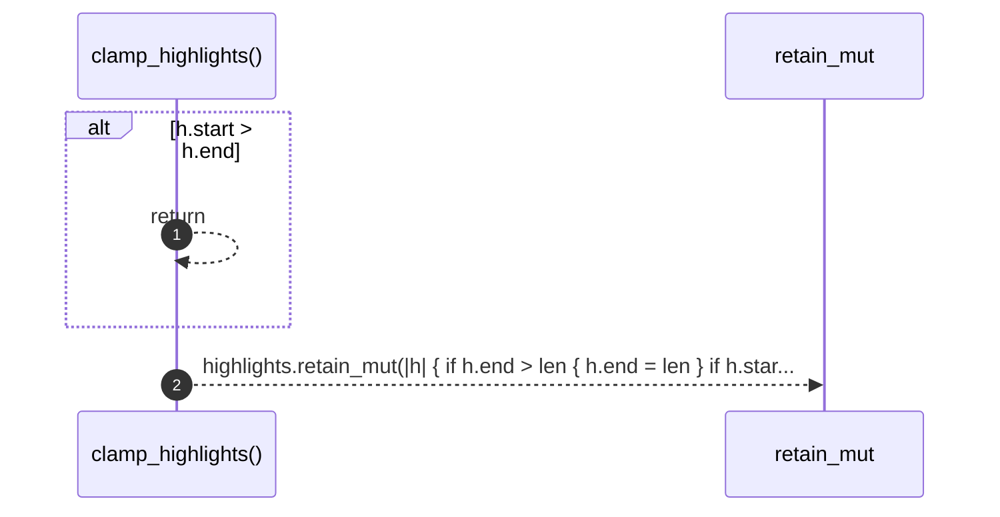

# `robby_agent::model::clamp_highlights`

[Self-model](../../README.md) · [model](index.md)

| | |
|---|---|
| kind | `code.function` |
| signature | `fn clamp_highlights(highlights: &mut Vec<Highlight>, len: u32)` |
| location | [`crates/robby-agent/src/model.rs:200`](../../../../crates/robby-agent/src/model.rs#L200) |
| provenance | extractor · confidence 1.00 |

```rust
fn clamp_highlights(highlights: &mut Vec<Highlight>, len: u32) {
    highlights.retain_mut(|h| {
        if h.end > len {
            h.end = len;
        }
        if h.start > h.end {
            return false;
        }
        h.start < h.end
    });
}
```



2 steps · 0 observed · 2 possible only

## Referenced by

- calls ← [`robby_agent::model::impl NoteModel<'a, C>::write_note`](index.md)

