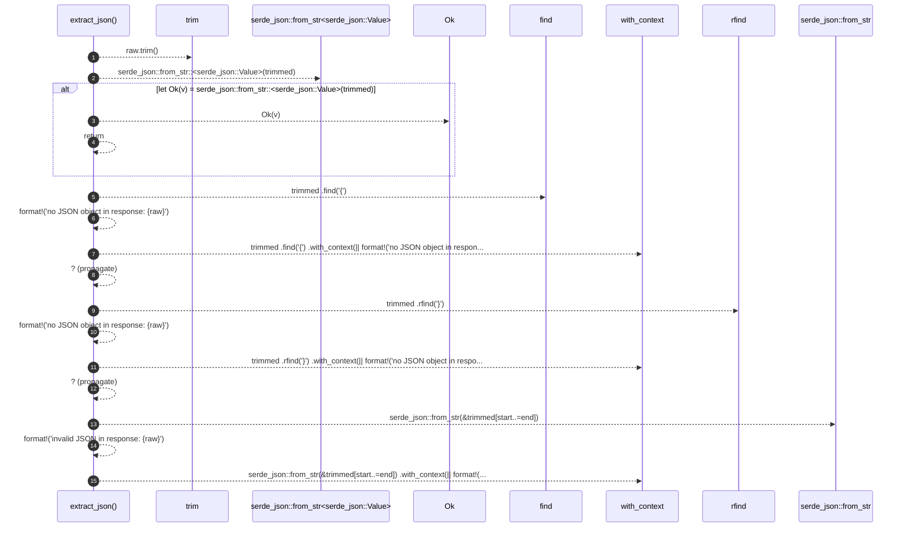

# `robby_agent::model::extract_json`

[Self-model](../../README.md) · [model](index.md)

| | |
|---|---|
| kind | `code.function` |
| signature | `fn extract_json(raw: &str) -> Result<serde_json::Value>` |
| location | [`crates/robby-agent/src/model.rs:185`](../../../../crates/robby-agent/src/model.rs#L185) |
| provenance | extractor · confidence 1.00 |

```rust
fn extract_json(raw: &str) -> Result<serde_json::Value> {
    let trimmed = raw.trim();
    if let Ok(v) = serde_json::from_str::<serde_json::Value>(trimmed) {
        return Ok(v);
    }
    let start = trimmed
        .find('{')
        .with_context(|| format!("no JSON object in response: {raw}"))?;
    let end = trimmed
        .rfind('}')
        .with_context(|| format!("no JSON object in response: {raw}"))?;
    serde_json::from_str(&trimmed[start..=end])
        .with_context(|| format!("invalid JSON in response: {raw}"))
}
```



15 steps · 0 observed · 15 possible only

## Referenced by

- calls ← [`robby_agent::model::parse_decision`](parse-decision.md)
- calls ← [`robby_agent::model::parse_note`](parse-note.md)

