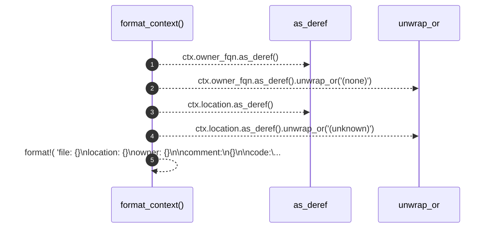

# `robby_agent::model::format_context`

[Self-model](../../README.md) · [model](index.md)

| | |
|---|---|
| kind | `code.function` |
| signature | `fn format_context(ctx: &CommentContext) -> String` |
| location | [`crates/robby-agent/src/model.rs:177`](../../../../crates/robby-agent/src/model.rs#L177) |
| provenance | extractor · confidence 1.00 |

```rust
fn format_context(ctx: &CommentContext) -> String {
    let owner = ctx.owner_fqn.as_deref().unwrap_or("(none)");
    let location = ctx.location.as_deref().unwrap_or("(unknown)");
    format!(
        "file: {}\nlocation: {}\nowner: {}\n\ncomment:\n{}\n\ncode:\n{}",
        ctx.file, location, owner, ctx.comment_text, ctx.code_window
    )
}
```



5 steps · 0 observed · 5 possible only

## Referenced by

- calls ← [`robby_agent::model::impl DecisionModel<'a, C>::decide`](index.md)
- calls ← [`robby_agent::model::impl NoteModel<'a, C>::write_note`](index.md)

