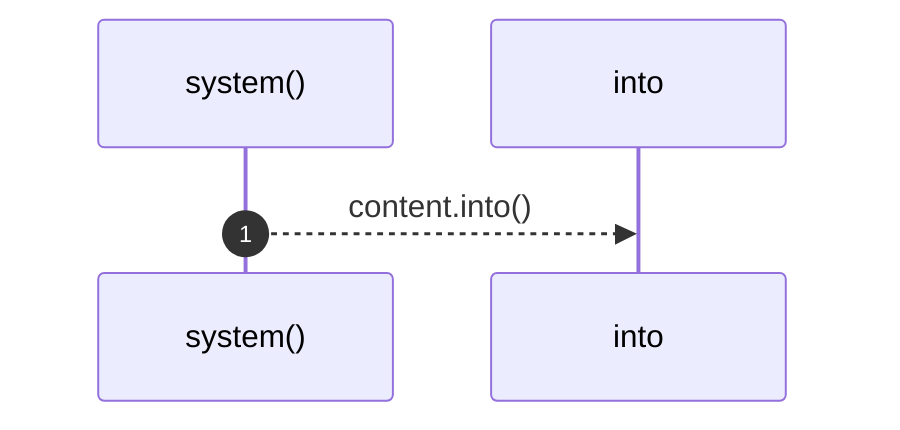
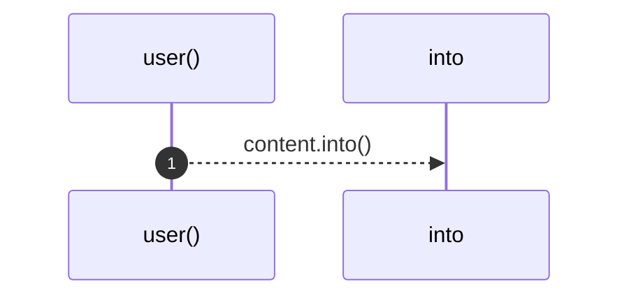

# `robby_agent::model::impl ChatMessage`

[Self-model](../../README.md) · [model](index.md)

| | |
|---|---|
| kind | `code.impl` |
| location | [`crates/robby-agent/src/model.rs:26`](../../../../crates/robby-agent/src/model.rs#L26) |
| provenance | extractor · confidence 1.00 |

```rust
impl ChatMessage {
    pub fn system(content: impl Into<String>) -> Self {
        Self {
            role: Role::System,
            content: content.into(),
        }
    }

    pub fn user(content: impl Into<String>) -> Self {
        Self {
            role: Role::User,
            content: content.into(),
        }
    }
}
```

## Referenced by

- calls ← [`robby_agent::model::impl DecisionModel<'a, C>::decide`](index.md)
- calls ← [`robby_agent::model::impl NoteModel<'a, C>::write_note`](index.md)

### `system`

| | |
|---|---|
| kind | `code.method` |
| signature | `fn system(1)` |
| location | [`crates/robby-agent/src/model.rs:27`](../../../../crates/robby-agent/src/model.rs#L27) |
| provenance | extractor · confidence 1.00 |

```rust
pub fn system(content: impl Into<String>) -> Self {
        Self {
            role: Role::System,
            content: content.into(),
        }
    }
```



1 steps · 0 observed · 1 possible only

### `user`

| | |
|---|---|
| kind | `code.method` |
| signature | `fn user(1)` |
| location | [`crates/robby-agent/src/model.rs:34`](../../../../crates/robby-agent/src/model.rs#L34) |
| provenance | extractor · confidence 1.00 |

```rust
pub fn user(content: impl Into<String>) -> Self {
        Self {
            role: Role::User,
            content: content.into(),
        }
    }
```



1 steps · 0 observed · 1 possible only

