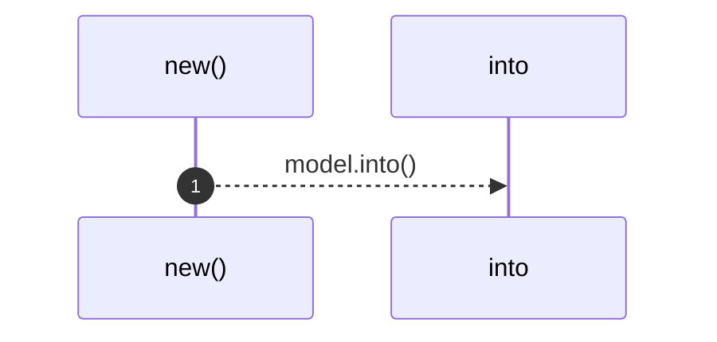
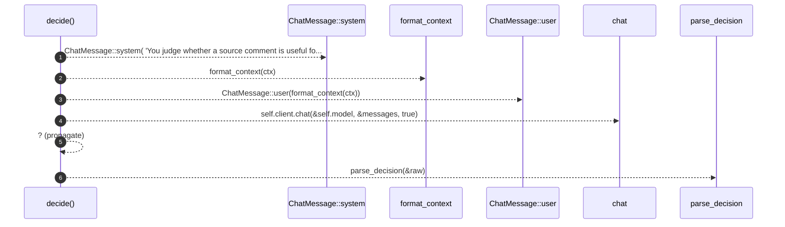

# `robby_agent::model::impl DecisionModel<'a, C>`

[Self-model](../../README.md) · [model](index.md)

| | |
|---|---|
| kind | `code.impl` |
| location | [`crates/robby-agent/src/model.rs:119`](../../../../crates/robby-agent/src/model.rs#L119) |
| provenance | extractor · confidence 1.00 |

```rust
impl<'a, C: ChatClient + ?Sized> DecisionModel<'a, C> {
    pub fn new(client: &'a C, model: impl Into<String>) -> Self {
        Self {
            client,
            model: model.into(),
        }
    }

    pub fn decide(&self, ctx: &CommentContext) -> Result<Decision> {
        let messages = [
            ChatMessage::system(
                "You judge whether a source comment is useful for a codebase map.\n\
                 Reply with JSON only: {\"verdict\":\"relevant\"|\"noise\",\"reason\":\"...\"}.\n\
                 Mark as noise: TODOs, license headers, commented-out code, noisy separators.\n\
                 Mark as relevant: API intent, invariants, usage hints, non-obvious behavior.",
            ),
            ChatMessage::user(format_context(ctx)),
        ];
        let raw = self.client.chat(&self.model, &messages, true)?;
        parse_decision(&raw)
    }
}
```

## References

- calls → [`robby_agent::model`](index.md) — 5 items

## Referenced by

- calls ← [`robby_agent::enrich::enrich_comments`](../enrich/enrich-comments.md)

### `new`

| | |
|---|---|
| kind | `code.method` |
| signature | `fn new(2)` |
| location | [`crates/robby-agent/src/model.rs:120`](../../../../crates/robby-agent/src/model.rs#L120) |
| provenance | extractor · confidence 1.00 |

```rust
pub fn new(client: &'a C, model: impl Into<String>) -> Self {
        Self {
            client,
            model: model.into(),
        }
    }
```



1 steps · 0 observed · 1 possible only

### `decide`

| | |
|---|---|
| kind | `code.method` |
| signature | `fn decide(2)` |
| location | [`crates/robby-agent/src/model.rs:127`](../../../../crates/robby-agent/src/model.rs#L127) |
| provenance | extractor · confidence 1.00 |

```rust
pub fn decide(&self, ctx: &CommentContext) -> Result<Decision> {
        let messages = [
            ChatMessage::system(
                "You judge whether a source comment is useful for a codebase map.\n\
                 Reply with JSON only: {\"verdict\":\"relevant\"|\"noise\",\"reason\":\"...\"}.\n\
                 Mark as noise: TODOs, license headers, commented-out code, noisy separators.\n\
                 Mark as relevant: API intent, invariants, usage hints, non-obvious behavior.",
            ),
            ChatMessage::user(format_context(ctx)),
        ];
        let raw = self.client.chat(&self.model, &messages, true)?;
        parse_decision(&raw)
    }
```



6 steps · 0 observed · 6 possible only

**Edges**

- calls → [`robby_agent::model::impl ChatMessage::system`](index.md)
- calls → [`robby_agent::model::format_context`](format-context.md)
- calls → [`robby_agent::model::impl ChatMessage::user`](index.md)
- calls → [`robby_agent::model::ChatClient::chat`](index.md)
- calls → [`robby_agent::model::parse_decision`](parse-decision.md)

