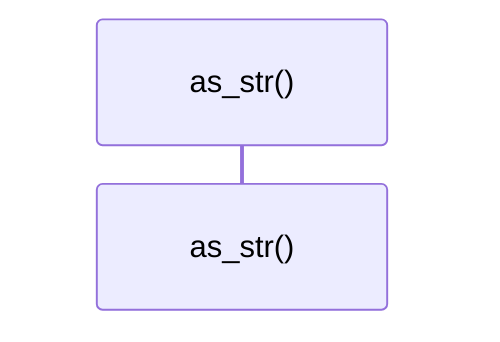
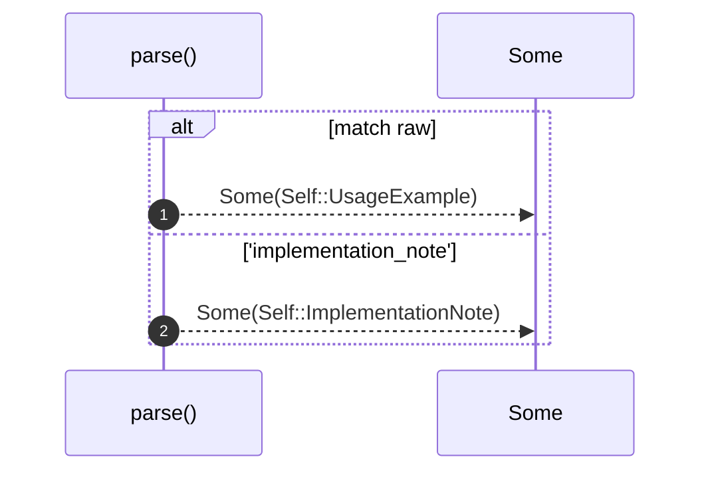

# `robby_agent::model::impl NoteKind`

[Self-model](../../README.md) · [model](index.md)

| | |
|---|---|
| kind | `code.impl` |
| location | [`crates/robby-agent/src/model.rs:83`](../../../../crates/robby-agent/src/model.rs#L83) |
| provenance | extractor · confidence 1.00 |

```rust
impl NoteKind {
    pub fn as_str(self) -> &'static str {
        match self {
            Self::UsageExample => "usage_example",
            Self::ImplementationNote => "implementation_note",
        }
    }

    pub fn parse(raw: &str) -> Option<Self> {
        match raw {
            "usage_example" => Some(Self::UsageExample),
            "implementation_note" => Some(Self::ImplementationNote),
            _ => None,
        }
    }
}
```

### `as_str`

| | |
|---|---|
| kind | `code.method` |
| signature | `fn as_str(1)` |
| location | [`crates/robby-agent/src/model.rs:84`](../../../../crates/robby-agent/src/model.rs#L84) |
| provenance | extractor · confidence 1.00 |

```rust
pub fn as_str(self) -> &'static str {
        match self {
            Self::UsageExample => "usage_example",
            Self::ImplementationNote => "implementation_note",
        }
    }
```



0 steps · 0 observed · 0 possible only

### `parse`

| | |
|---|---|
| kind | `code.method` |
| signature | `fn parse(1)` |
| location | [`crates/robby-agent/src/model.rs:91`](../../../../crates/robby-agent/src/model.rs#L91) |
| provenance | extractor · confidence 1.00 |

```rust
pub fn parse(raw: &str) -> Option<Self> {
        match raw {
            "usage_example" => Some(Self::UsageExample),
            "implementation_note" => Some(Self::ImplementationNote),
            _ => None,
        }
    }
```



2 steps · 0 observed · 2 possible only

