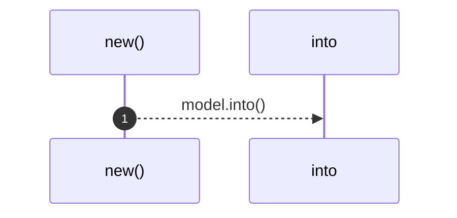
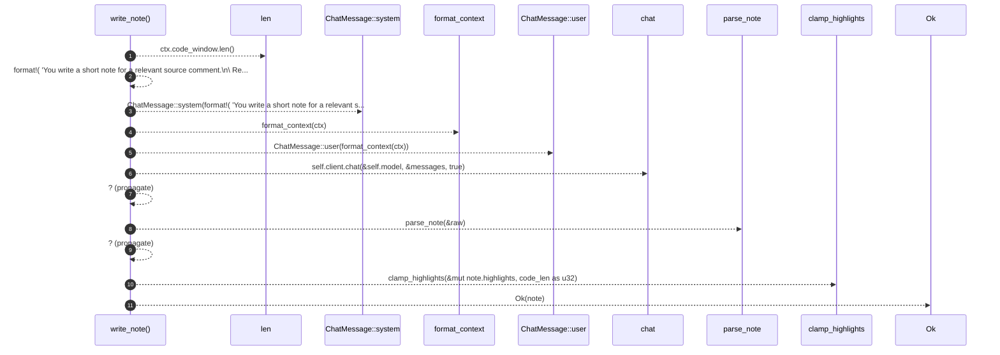

# `robby_agent::model::impl NoteModel<'a, C>`

[Self-model](../../README.md) · [model](index.md)

| | |
|---|---|
| kind | `code.impl` |
| location | [`crates/robby-agent/src/model.rs:95`](../../../../crates/robby-agent/src/model.rs#L95) |
| provenance | extractor · confidence 1.00 |

```rust
impl<'a, C: ChatClient + ?Sized> NoteModel<'a, C> {
    pub fn new(client: &'a C, model: impl Into<String>) -> Self {
        Self {
            client,
            model: model.into(),
        }
    }

    pub fn write_note(&self, ctx: &CommentContext) -> Result<Note> {
        let code_len = ctx.code_window.len();
        let messages = [
            ChatMessage::system(format!(
                "You write a short note for a relevant source comment.\n\
                 Reply with JSON only:\n\
                 {{\"kind\":\"usage_example\"|\"implementation_note\",\"body\":\"...\",\
                 \"highlights\":[{{\"start\":0,\"end\":0}}]}}\n\
                 - usage_example: how a caller should use the code.\n\
                 - implementation_note: non-obvious implementation detail.\n\
                 highlights are UTF-8 byte offsets into the code window (length {code_len}).\n\
                 Prefer 0–3 tight highlights; empty array is ok."
            )),
            ChatMessage::user(format_context(ctx)),
        ];
        let raw = self.client.chat(&self.model, &messages, true)?;
        let mut note = parse_note(&raw)?;
        clamp_highlights(&mut note.highlights, code_len as u32);
        Ok(note)
    }
}
```

## References

- calls → [`robby_agent::model`](index.md) — 6 items

## Referenced by

- calls ← [`robby_agent::enrich::enrich_comments`](../enrich/enrich-comments.md)

### `new`

| | |
|---|---|
| kind | `code.method` |
| signature | `fn new(2)` |
| location | [`crates/robby-agent/src/model.rs:96`](../../../../crates/robby-agent/src/model.rs#L96) |
| provenance | extractor · confidence 1.00 |

```rust
pub fn new(client: &'a C, model: impl Into<String>) -> Self {
        Self {
            client,
            model: model.into(),
        }
    }
```



1 steps · 0 observed · 1 possible only

### `write_note`

| | |
|---|---|
| kind | `code.method` |
| signature | `fn write_note(2)` |
| location | [`crates/robby-agent/src/model.rs:103`](../../../../crates/robby-agent/src/model.rs#L103) |
| provenance | extractor · confidence 1.00 |

```rust
pub fn write_note(&self, ctx: &CommentContext) -> Result<Note> {
        let code_len = ctx.code_window.len();
        let messages = [
            ChatMessage::system(format!(
                "You write a short note for a relevant source comment.\n\
                 Reply with JSON only:\n\
                 {{\"kind\":\"usage_example\"|\"implementation_note\",\"body\":\"...\",\
                 \"highlights\":[{{\"start\":0,\"end\":0}}]}}\n\
                 - usage_example: how a caller should use the code.\n\
                 - implementation_note: non-obvious implementation detail.\n\
                 highlights are UTF-8 byte offsets into the code window (length {code_len}).\n\
                 Prefer 0–3 tight highlights; empty array is ok."
            )),
            ChatMessage::user(format_context(ctx)),
        ];
        let raw = self.client.chat(&self.model, &messages, true)?;
        let mut note = parse_note(&raw)?;
        clamp_highlights(&mut note.highlights, code_len as u32);
        Ok(note)
    }
```



11 steps · 0 observed · 11 possible only

**Edges**

- calls → [`robby_agent::model::impl ChatMessage::system`](index.md)
- calls → [`robby_agent::model::format_context`](format-context.md)
- calls → [`robby_agent::model::impl ChatMessage::user`](index.md)
- calls → [`robby_agent::model::ChatClient::chat`](index.md)
- calls → [`robby_agent::model::parse_note`](parse-note.md)
- calls → [`robby_agent::model::clamp_highlights`](clamp-highlights.md)

