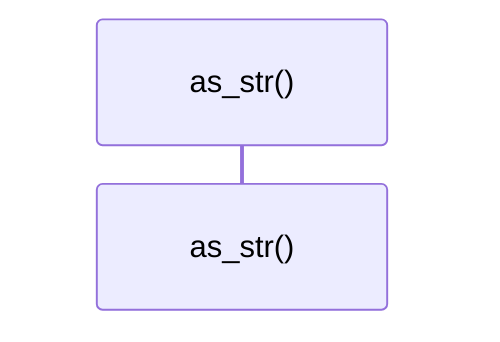
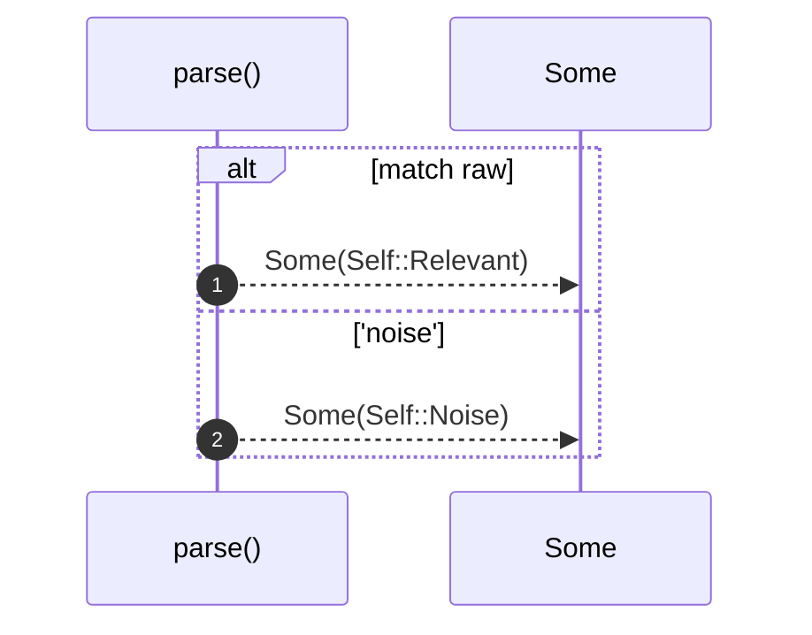

# `robby_agent::model::impl Verdict`

[Self-model](../../README.md) · [model](index.md)

| | |
|---|---|
| kind | `code.impl` |
| location | [`crates/robby-agent/src/model.rs:52`](../../../../crates/robby-agent/src/model.rs#L52) |
| provenance | extractor · confidence 1.00 |

```rust
impl Verdict {
    pub fn as_str(self) -> &'static str {
        match self {
            Self::Relevant => "relevant",
            Self::Noise => "noise",
        }
    }

    pub fn parse(raw: &str) -> Option<Self> {
        match raw {
            "relevant" => Some(Self::Relevant),
            "noise" => Some(Self::Noise),
            _ => None,
        }
    }
}
```

## Referenced by

- calls ← [`robby_agent::context::collect_comment_contexts`](../context/collect-comment-contexts.md)
- calls ← [`robby_agent::context::has_decision_child`](../context/has-decision-child.md)
- calls ← [`robby_agent::context::parent_has_comment_with_text`](../context/parent-has-comment-with-text.md)
- calls ← [`robby_agent::enrich::insert_decision`](../enrich/insert-decision.md)
- calls ← [`robby_agent::enrich::noise_short_circuits_without_note_call`](../enrich/tests/noise-short-circuits-without-note-call.md)
- calls ← [`robby_agent::enrich::relevant_writes_note_and_highlights`](../enrich/tests/relevant-writes-note-and-highlights.md)
- calls ← [`robby_agent::model::parse_decision`](parse-decision.md)
- calls ← [`robby_agent::model::parse_note`](parse-note.md)
- calls ← [`robby_cli::example_self_model::run`](../../robby_cli/example_self_model/run.md)
- calls ← [`robby_cli::run`](../../robby_cli/run.md)
- calls ← [`robby_extract::typescript::extract_file`](../../robby_extract/typescript/extract-file.md)

### `as_str`

| | |
|---|---|
| kind | `code.method` |
| signature | `fn as_str(1)` |
| location | [`crates/robby-agent/src/model.rs:53`](../../../../crates/robby-agent/src/model.rs#L53) |
| provenance | extractor · confidence 1.00 |

```rust
pub fn as_str(self) -> &'static str {
        match self {
            Self::Relevant => "relevant",
            Self::Noise => "noise",
        }
    }
```



0 steps · 0 observed · 0 possible only

### `parse`

| | |
|---|---|
| kind | `code.method` |
| signature | `fn parse(1)` |
| location | [`crates/robby-agent/src/model.rs:60`](../../../../crates/robby-agent/src/model.rs#L60) |
| provenance | extractor · confidence 1.00 |

```rust
pub fn parse(raw: &str) -> Option<Self> {
        match raw {
            "relevant" => Some(Self::Relevant),
            "noise" => Some(Self::Noise),
            _ => None,
        }
    }
```



2 steps · 0 observed · 2 possible only

