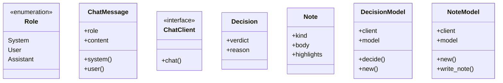
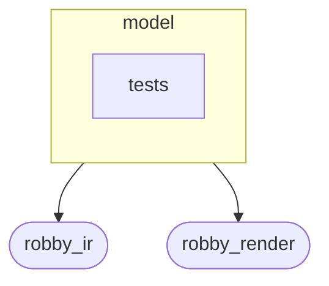
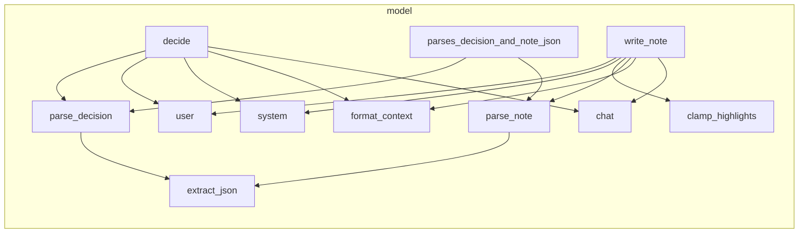

# `robby_agent::model`

[Self-model](../../README.md) · [robby_agent](../index.md)

| | |
|---|---|
| kind | `code.module` |
| declared at | [`crates/robby-agent/src/lib.rs:8`](../../../../crates/robby-agent/src/lib.rs#L8) |
| provenance | extractor · confidence 1.00 |
| nodes | 46 |

## Types



## Package diagram



## Module coupling



## Dependency matrix

| | model | tests | robby_ir | robby_render |
|---|---:|---:|---:|---:|
| **model** | · | | 12 | 1 |
| **tests** | | · | | |
| **robby_ir** | | | · | |
| **robby_render** | | | | · |

## Comments

- `crates/robby-agent/src/model.rs:42:1` (docs, `robby_agent::model::ChatClient`): "Pluggable chat backend (OpenRouter or fakes in tests)."
  ```
  /// Pluggable chat backend (OpenRouter or fakes in tests).
  pub trait ChatClient {
      fn chat(&self, model: &str, messages: &[ChatMessage], json_mode: bool) -> Result<String>;
  }
  ```
## References

- calls → [`robby_ir::kind`](../../robby_ir/kind/index.md) — as_str
- calls → [`robby_ir::model`](../../robby_ir/model/index.md) — get
- calls → [`robby_ir::span`](../../robby_ir/span/index.md) — is_empty
- calls → [`robby_render::view::select`](../../robby_render/view/select/index.md) — collect

## Referenced by

- calls ← [`robby_agent::enrich::enrich_comments`](../enrich/enrich-comments.md)

## Modules

- [`model::tests`](tests/index.md) — 3 nodes

## Items

| Item | Kind | Steps | Location |
|---|---|---:|---|
| [`DEFAULT_DECISION_MODEL`](default-decision-model.md) | `code.const` | — | `crates/robby-agent/src/model.rs:10:1` |
| [`DEFAULT_NOTE_MODEL`](default-note-model.md) | `code.const` | — | `crates/robby-agent/src/model.rs:11:1` |
| [`Role`](role.md) | `code.enum` | — | `crates/robby-agent/src/model.rs:13:1` |
| [`ChatMessage`](chatmessage.md) | `code.struct` | — | `crates/robby-agent/src/model.rs:20:1` |
| [`impl ChatMessage`](impl-chatmessage.md) | `code.impl` | — | `crates/robby-agent/src/model.rs:26:1` |
| [`ChatClient`](chatclient.md) | `code.trait` | — | `crates/robby-agent/src/model.rs:42:1` |
| [`Decision`](decision.md) | `code.struct` | — | `crates/robby-agent/src/model.rs:47:1` |
| [`Note`](note.md) | `code.struct` | — | `crates/robby-agent/src/model.rs:54:1` |
| [`DecisionModel`](decisionmodel.md) | `code.struct` | — | `crates/robby-agent/src/model.rs:62:1` |
| [`impl DecisionModel<'a, C>`](impl-decisionmodel-a-c.md) | `code.impl` | — | `crates/robby-agent/src/model.rs:67:1` |
| [`NoteModel`](notemodel.md) | `code.struct` | — | `crates/robby-agent/src/model.rs:90:1` |
| [`impl NoteModel<'a, C>`](impl-notemodel-a-c.md) | `code.impl` | — | `crates/robby-agent/src/model.rs:95:1` |
| [`format_context`](format-context.md) | `code.function` | 5 | `crates/robby-agent/src/model.rs:125:1` |
| [`parse_decision`](parse-decision.md) | `code.function` | 15 | `crates/robby-agent/src/model.rs:134:1` |
| [`parse_note`](parse-note.md) | `code.function` | 35 | `crates/robby-agent/src/model.rs:149:1` |
| [`extract_json`](extract-json.md) | `code.function` | 15 | `crates/robby-agent/src/model.rs:185:1` |
| [`clamp_highlights`](clamp-highlights.md) | `code.function` | 2 | `crates/robby-agent/src/model.rs:200:1` |

## Imports

- `use anyhow::{Context, Result, bail};`
- `use serde::{Deserialize, Serialize};`
- `use crate::context::CommentContext;`
- [`pub use robby_ir::{Highlight, NoteKind, Verdict};`](../../robby_ir/index.md)

