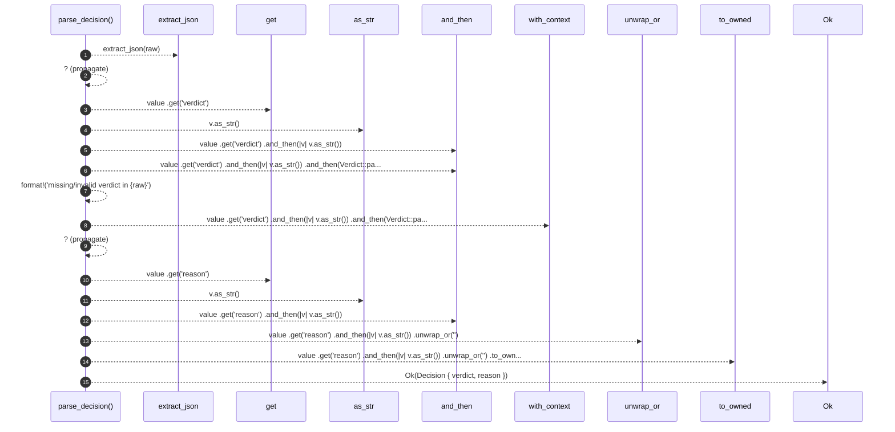

# `robby_agent::model::parse_decision`

[Self-model](../../README.md) · [model](index.md)

| | |
|---|---|
| kind | `code.function` |
| signature | `fn parse_decision(raw: &str) -> Result<Decision>` |
| location | [`crates/robby-agent/src/model.rs:186`](../../../../crates/robby-agent/src/model.rs#L186) |
| provenance | extractor · confidence 1.00 |

```rust
fn parse_decision(raw: &str) -> Result<Decision> {
    let value = extract_json(raw)?;
    let verdict = value
        .get("verdict")
        .and_then(|v| v.as_str())
        .and_then(Verdict::parse)
        .with_context(|| format!("missing/invalid verdict in {raw}"))?;
    let reason = value
        .get("reason")
        .and_then(|v| v.as_str())
        .unwrap_or("")
        .to_owned();
    Ok(Decision { verdict, reason })
}
```



15 steps · 0 observed · 15 possible only

**Edges**

- calls → [`robby_agent::model::extract_json`](extract-json.md)
- calls → [`robby_ir::model::impl Document::get`](../../robby_ir/model/index.md)
- calls → [`robby_agent::model::impl Verdict::as_str`](index.md)
- calls → [`robby_ir::model::impl Document::get`](../../robby_ir/model/index.md)
- calls → [`robby_agent::model::impl Verdict::as_str`](index.md)

## References

- calls → [`robby_agent::model`](index.md) — as_str, extract_json
- calls → [`robby_ir::model`](../../robby_ir/model/index.md) — get

## Referenced by

- calls ← [`robby_agent::model::impl DecisionModel<'a, C>::decide`](index.md)
- calls ← [`robby_agent::model::parses_decision_and_note_json`](tests/parses-decision-and-note-json.md)

