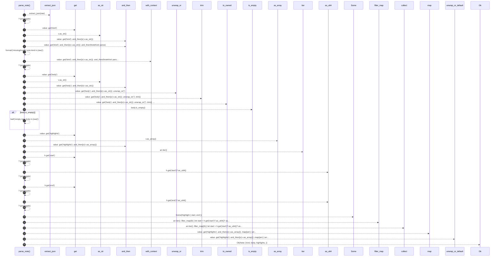

# `robby_agent::model::parse_note`

[Self-model](../../README.md) · [model](index.md)

| | |
|---|---|
| kind | `code.function` |
| signature | `fn parse_note(raw: &str) -> Result<Note>` |
| location | [`crates/robby-agent/src/model.rs:149`](../../../../crates/robby-agent/src/model.rs#L149) |
| provenance | extractor · confidence 1.00 |

```rust
fn parse_note(raw: &str) -> Result<Note> {
    let value = extract_json(raw)?;
    let kind = value
        .get("kind")
        .and_then(|v| v.as_str())
        .and_then(NoteKind::parse)
        .with_context(|| format!("missing/invalid note kind in {raw}"))?;
    let body = value
        .get("body")
        .and_then(|v| v.as_str())
        .unwrap_or("")
        .trim()
        .to_owned();
    if body.is_empty() {
        bail!("empty note body in {raw}");
    }
    let highlights = value
        .get("highlights")
        .and_then(|v| v.as_array())
        .map(|arr| {
            arr.iter()
                .filter_map(|h| {
                    let start = h.get("start")?.as_u64()? as u32;
                    let end = h.get("end")?.as_u64()? as u32;
                    Some(Highlight { start, end })
                })
                .collect()
        })
        .unwrap_or_default();
    Ok(Note {
        kind,
        body,
        highlights,
    })
}
```



35 steps · 0 observed · 35 possible only

**Edges**

- calls → [`robby_agent::model::extract_json`](extract-json.md)
- calls → [`robby_ir::run::RecipeCatalog::get`](../../robby_ir/run/index.md)
- calls → [`robby_ir::kind::impl Kind::as_str`](../../robby_ir/kind/index.md)
- calls → [`robby_ir::run::RecipeCatalog::get`](../../robby_ir/run/index.md)
- calls → [`robby_ir::kind::impl Kind::as_str`](../../robby_ir/kind/index.md)
- calls → [`robby_ir::span::impl Span::is_empty`](../../robby_ir/span/index.md)
- calls → [`robby_ir::run::RecipeCatalog::get`](../../robby_ir/run/index.md)
- calls → [`robby_ir::run::RecipeCatalog::get`](../../robby_ir/run/index.md)
- calls → [`robby_ir::run::RecipeCatalog::get`](../../robby_ir/run/index.md)
- calls → [`robby_render::view::select::collect`](../../robby_render/view/select/collect.md)

## References

- calls → [`robby_agent::model`](index.md) — extract_json
- calls → [`robby_ir::kind`](../../robby_ir/kind/index.md) — as_str
- calls → [`robby_ir::run`](../../robby_ir/run/index.md) — get
- calls → [`robby_ir::span`](../../robby_ir/span/index.md) — is_empty
- calls → [`robby_render::view::select`](../../robby_render/view/select/index.md) — collect

## Referenced by

- calls ← [`robby_agent::model::impl NoteModel<'a, C>::write_note`](index.md)
- calls ← [`robby_agent::model::parses_decision_and_note_json`](tests/parses-decision-and-note-json.md)

