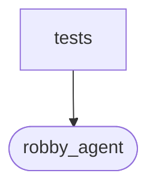

# `robby_agent::model::tests`

[Self-model](../../../README.md) · [model](../index.md)

| | |
|---|---|
| kind | `code.module` |
| declared at | [`crates/robby-agent/src/model.rs:264`](../../../../../crates/robby-agent/src/model.rs#L264) |
| provenance | extractor · confidence 1.00 |
| nodes | 3 |

## Package diagram

## Dependency matrix

| | tests | robby_agent |
|---|---:|---:|
| **tests** | · | 2 |
| **robby_agent** | | · |
## References

- calls → [`robby_agent::model`](../index.md) — parse_decision, parse_note

## Items

| Item | Kind | Steps | Location |
|---|---|---:|---|
| [`parses_decision_and_note_json`](parses-decision-and-note-json.md) | `code.function` | 7 | `crates/robby-agent/src/model.rs:268:5` |

## Imports

- `use super::*;`

