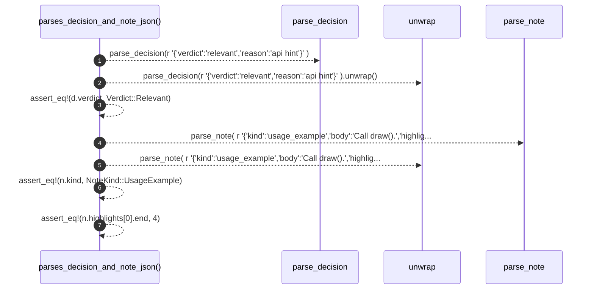

# `robby_agent::model::parses_decision_and_note_json`

[Self-model](../../../README.md) · [model::tests](index.md)

| | |
|---|---|
| kind | `code.function` |
| signature | `fn parses_decision_and_note_json()` |
| location | [`crates/robby-agent/src/model.rs:268`](../../../../../crates/robby-agent/src/model.rs#L268) |
| provenance | extractor · confidence 1.00 |

```rust
#[test]
    fn parses_decision_and_note_json() {
        let d = parse_decision(r#"{"verdict":"relevant","reason":"api hint"}"#).unwrap();
        assert_eq!(d.verdict, Verdict::Relevant);
        let n = parse_note(
            r#"{"kind":"usage_example","body":"Call draw().","highlights":[{"start":0,"end":4}]}"#,
        )
        .unwrap();
        assert_eq!(n.kind, NoteKind::UsageExample);
        assert_eq!(n.highlights[0].end, 4);
    }
```



7 steps · 0 observed · 7 possible only

**Edges**

- calls → [`robby_agent::model::parse_decision`](../parse-decision.md)
- calls → [`robby_agent::model::parse_note`](../parse-note.md)

## References

- calls → [`robby_agent::model`](../index.md) — parse_decision, parse_note

