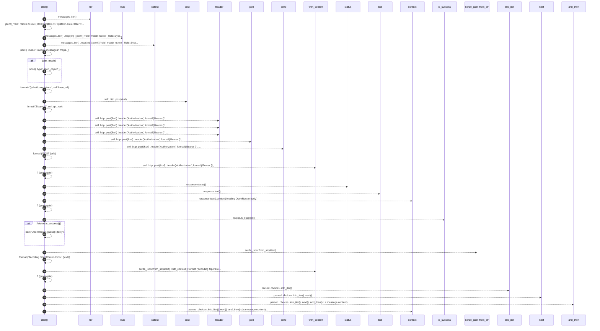

# `robby_agent::openrouter::impl ChatClient for OpenRouterClient`

[Self-model](../../README.md) · [openrouter](index.md)

| | |
|---|---|
| kind | `code.impl` |
| location | [`crates/robby-agent/src/openrouter.rs:41`](../../../../crates/robby-agent/src/openrouter.rs#L41) |
| provenance | extractor · confidence 1.00 |

```rust
impl ChatClient for OpenRouterClient {
    fn chat(&self, model: &str, messages: &[ChatMessage], json_mode: bool) -> Result<String> {
        let msgs: Vec<_> = messages
            .iter()
            .map(|m| {
                json!({
                    "role": match m.role {
                        Role::System => "system",
                        Role::User => "user",
                        Role::Assistant => "assistant",
                    },
                    "content": m.content,
                })
            })
            .collect();

        let mut body = json!({
            "model": model,
            "messages": msgs,
        });
        if json_mode {
            body["response_format"] = json!({ "type": "json_object" });
        }

        let url = format!("{}/chat/completions", self.base_url);
        let response = self
            .http
            .post(&url)
            .header("Authorization", format!("Bearer {}", self.api_key))
            .header("HTTP-Referer", "https://github.com/robby/robby")
            .header("X-Title", "robby")
            .json(&body)
            .send()
            .with_context(|| format!("POST {url}"))?;

        let status = response.status();
        let text = response.text().context("reading OpenRouter body")?;
        if !status.is_success() {
            bail!("OpenRouter {status}: {text}");
        }

        let parsed: ChatCompletion = serde_json::from_str(&text)
            .with_context(|| format!("decoding OpenRouter JSON: {text}"))?;
        parsed
            .choices
            .into_iter()
            .next()
            .and_then(|c| c.message.content)
            .context("OpenRouter response missing choices[0].message.content")
    }
}
```

## References

- calls → [`robby_render::util`](../../robby_render/util/index.md) — text
- calls → [`robby_render::view::select`](../../robby_render/view/select/index.md) — collect

### `chat`

| | |
|---|---|
| kind | `code.method` |
| signature | `fn chat(4)` |
| location | [`crates/robby-agent/src/openrouter.rs:42`](../../../../crates/robby-agent/src/openrouter.rs#L42) |
| provenance | extractor · confidence 1.00 |

```rust
fn chat(&self, model: &str, messages: &[ChatMessage], json_mode: bool) -> Result<String> {
        let msgs: Vec<_> = messages
            .iter()
            .map(|m| {
                json!({
                    "role": match m.role {
                        Role::System => "system",
                        Role::User => "user",
                        Role::Assistant => "assistant",
                    },
                    "content": m.content,
                })
            })
            .collect();

        let mut body = json!({
            "model": model,
            "messages": msgs,
        });
        if json_mode {
            body["response_format"] = json!({ "type": "json_object" });
        }

        let url = format!("{}/chat/completions", self.base_url);
        let response = self
            .http
            .post(&url)
            .header("Authorization", format!("Bearer {}", self.api_key))
            .header("HTTP-Referer", "https://github.com/robby/robby")
            .header("X-Title", "robby")
            .json(&body)
            .send()
            .with_context(|| format!("POST {url}"))?;

        let status = response.status();
        let text = response.text().context("reading OpenRouter body")?;
        if !status.is_success() {
            bail!("OpenRouter {status}: {text}");
        }

        let parsed: ChatCompletion = serde_json::from_str(&text)
            .with_context(|| format!("decoding OpenRouter JSON: {text}"))?;
        parsed
            .choices
            .into_iter()
            .next()
            .and_then(|c| c.message.content)
            .context("OpenRouter response missing choices[0].message.content")
    }
```



31 steps · 0 observed · 31 possible only

**Edges**

- calls → [`robby_render::view::select::collect`](../../robby_render/view/select/collect.md)
- calls → [`robby_render::util::text`](../../robby_render/util/text.md)

