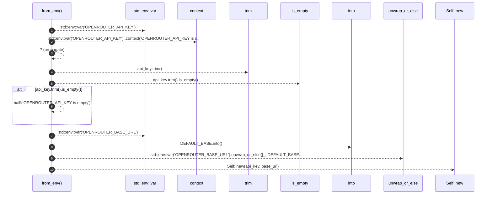
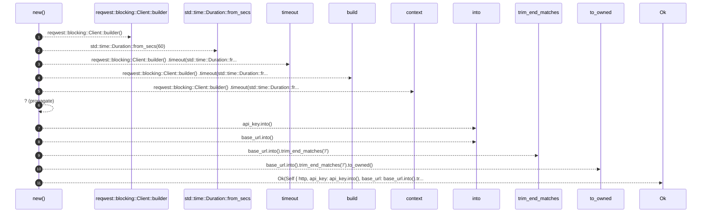

# `robby_agent::openrouter::impl OpenRouterClient`

[Self-model](../../README.md) · [openrouter](index.md)

| | |
|---|---|
| kind | `code.impl` |
| location | [`crates/robby-agent/src/openrouter.rs:17`](../../../../crates/robby-agent/src/openrouter.rs#L17) |
| provenance | extractor · confidence 1.00 |

```rust
impl OpenRouterClient {
    pub fn from_env() -> Result<Self> {
        let api_key = std::env::var("OPENROUTER_API_KEY")
            .context("OPENROUTER_API_KEY is required for enrich-comments")?;
        if api_key.trim().is_empty() {
            bail!("OPENROUTER_API_KEY is empty");
        }
        let base_url = std::env::var("OPENROUTER_BASE_URL").unwrap_or_else(|_| DEFAULT_BASE.into());
        Self::new(api_key, base_url)
    }

    pub fn new(api_key: impl Into<String>, base_url: impl Into<String>) -> Result<Self> {
        let http = reqwest::blocking::Client::builder()
            .timeout(std::time::Duration::from_secs(60))
            .build()
            .context("building HTTP client")?;
        Ok(Self {
            http,
            api_key: api_key.into(),
            base_url: base_url.into().trim_end_matches('/').to_owned(),
        })
    }
}
```

## References

- calls → [`robby_ir::span`](../../robby_ir/span/index.md) — is_empty
- calls → [`robby_render::view::hierarchy`](../../robby_render/view/hierarchy/index.md) — build

## Referenced by

- calls ← [`robby_cli::enrich_comments`](../../robby_cli/enrich-comments.md)

### `from_env`

| | |
|---|---|
| kind | `code.method` |
| signature | `fn from_env(0)` |
| location | [`crates/robby-agent/src/openrouter.rs:18`](../../../../crates/robby-agent/src/openrouter.rs#L18) |
| provenance | extractor · confidence 1.00 |

```rust
pub fn from_env() -> Result<Self> {
        let api_key = std::env::var("OPENROUTER_API_KEY")
            .context("OPENROUTER_API_KEY is required for enrich-comments")?;
        if api_key.trim().is_empty() {
            bail!("OPENROUTER_API_KEY is empty");
        }
        let base_url = std::env::var("OPENROUTER_BASE_URL").unwrap_or_else(|_| DEFAULT_BASE.into());
        Self::new(api_key, base_url)
    }
```



10 steps · 0 observed · 10 possible only

**Edges**

- calls → [`robby_ir::span::impl Span::is_empty`](../../robby_ir/span/index.md)
- calls → [`robby_agent::openrouter::impl OpenRouterClient::new`](index.md)

### `new`

| | |
|---|---|
| kind | `code.method` |
| signature | `fn new(2)` |
| location | [`crates/robby-agent/src/openrouter.rs:28`](../../../../crates/robby-agent/src/openrouter.rs#L28) |
| provenance | extractor · confidence 1.00 |

```rust
pub fn new(api_key: impl Into<String>, base_url: impl Into<String>) -> Result<Self> {
        let http = reqwest::blocking::Client::builder()
            .timeout(std::time::Duration::from_secs(60))
            .build()
            .context("building HTTP client")?;
        Ok(Self {
            http,
            api_key: api_key.into(),
            base_url: base_url.into().trim_end_matches('/').to_owned(),
        })
    }
```



11 steps · 0 observed · 11 possible only

**Edges**

- calls → [`robby_render::view::hierarchy::build`](../../robby_render/view/hierarchy/build.md)

