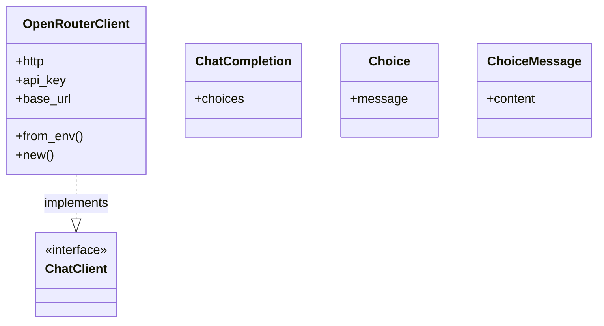
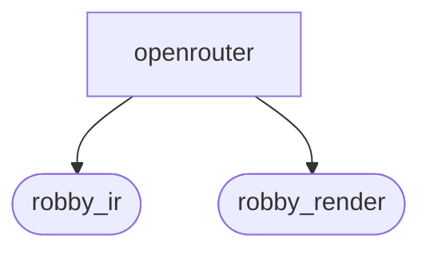
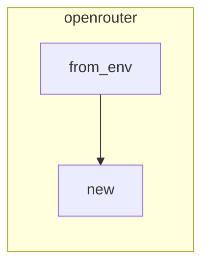

# `robby_agent::openrouter`

[Self-model](../../README.md) · [robby_agent](../index.md)

| | |
|---|---|
| kind | `code.module` |
| declared at | [`crates/robby-agent/src/lib.rs:9`](../../../../crates/robby-agent/src/lib.rs#L9) |
| provenance | extractor · confidence 1.00 |
| nodes | 21 |

## Types

## Package diagram

## Module coupling

## Dependency matrix

| | openrouter | robby_ir | robby_render |
|---|---:|---:|---:|
| **openrouter** | · | 2 | 3 |
| **robby_ir** | | · | |
| **robby_render** | | | · |
## References

- calls → [`robby_ir::run`](../../robby_ir/run/index.md) — is_success
- calls → [`robby_ir::span`](../../robby_ir/span/index.md) — is_empty
- calls → [`robby_render::util`](../../robby_render/util/index.md) — text
- calls → [`robby_render::view::hierarchy`](../../robby_render/view/hierarchy/index.md) — build
- calls → [`robby_render::view::select`](../../robby_render/view/select/index.md) — collect

## Referenced by

- calls ← [`robby_cli::enrich_comments`](../../robby_cli/enrich-comments.md)

## Items

| Item | Kind | Steps | Location |
|---|---|---:|---|
| [`DEFAULT_BASE`](default-base.md) | `code.const` | — | `crates/robby-agent/src/openrouter.rs:9:1` |
| [`OpenRouterClient`](openrouterclient.md) | `code.struct` | — | `crates/robby-agent/src/openrouter.rs:11:1` |
| [`impl OpenRouterClient`](impl-openrouterclient.md) | `code.impl` | — | `crates/robby-agent/src/openrouter.rs:17:1` |
| [`impl ChatClient for OpenRouterClient`](impl-chatclient-for-openrouterclient.md) | `code.impl` | — | `crates/robby-agent/src/openrouter.rs:41:1` |
| [`ChatCompletion`](chatcompletion.md) | `code.struct` | — | `crates/robby-agent/src/openrouter.rs:93:1` |
| [`Choice`](choice.md) | `code.struct` | — | `crates/robby-agent/src/openrouter.rs:98:1` |
| [`ChoiceMessage`](choicemessage.md) | `code.struct` | — | `crates/robby-agent/src/openrouter.rs:103:1` |

## Imports

- `use anyhow::{Context, Result, bail};`
- `use serde::Deserialize;`
- `use serde_json::json;`
- `use crate::model::{ChatClient, ChatMessage, Role};`

