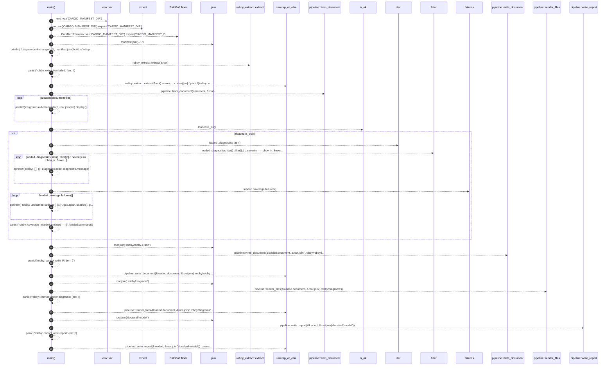
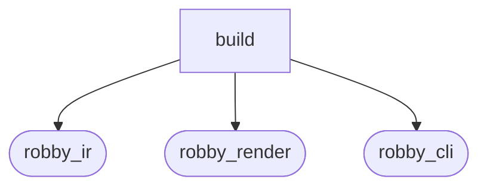

# `robby_cli::build`

[Self-model](../../README.md) · [robby_cli](../index.md)

| | |
|---|---|
| kind | `code.module` |
| provenance | extractor · confidence 1.00 |
| nodes | 5 |

## Entry

## Package diagram

## Dependency matrix

| | build | robby_ir | robby_render | robby_cli |
|---|---:|---:|---:|---:|
| **build** | · | 2 | 5 | 1 |
| **robby_ir** | | · | | |
| **robby_render** | | | · | |
| **robby_cli** | | | | · |
## References

- calls → [`robby_cli`](../index.md) — extract
- calls → [`robby_ir::coverage`](../../robby_ir/coverage/index.md) — failures
- calls → [`robby_ir::kind`](../../robby_ir/kind/index.md) — from
- calls → [`robby_render::pipeline`](../../robby_render/pipeline/index.md) — 5 items

## Items

| Item | Kind | Steps | Location |
|---|---|---:|---|
| [`main`](main.md) | `code.function` | 29 | `crates/robby-cli/build.rs:19:1` |

## Imports

- `use std::env;`
- `use std::path::PathBuf;`
- [`use robby_render::pipeline;`](../../robby_render/pipeline/index.md)

