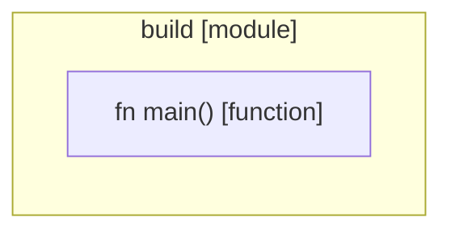

# `robby_cli::build`

[Self-model](../../README.md) · [robby_cli](../index.md)

| | |
|---|---|
| kind | `code.module` |
| provenance | extractor · confidence 1.00 |
| nodes | 5 |

## Items

| Item | Kind | Steps | Location |
|---|---|---:|---|
| [`main`](main.md) | `code.function` | 13 | `crates/robby-cli/build.rs:19:1` |

## Imports

- `use std::env;`
- `use std::path::PathBuf;`
- `use robby_render::pipeline;`

