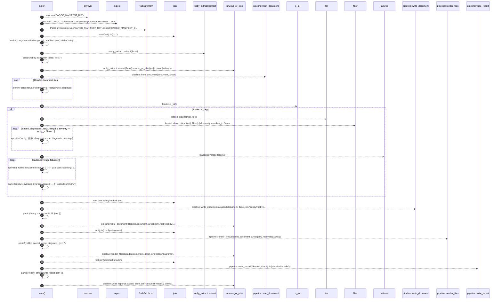

# `robby_cli::build::main`

[Self-model](../../README.md) · [build](index.md)

| | |
|---|---|
| kind | `code.function` |
| signature | `fn main()` |
| location | [`crates/robby-cli/build.rs:19`](../../../../crates/robby-cli/build.rs#L19) |
| provenance | extractor · confidence 1.00 |

```rust
fn main() {
    let manifest = PathBuf::from(env::var("CARGO_MANIFEST_DIR").expect("CARGO_MANIFEST_DIR"));
    let root = manifest.join("../..");

    println!(
        "cargo:rerun-if-changed={}",
        manifest.join("build.rs").display()
    );

    let document = robby_extract::extract(&root).unwrap_or_else(|err| {
        panic!("robby: extraction failed: {err:#}");
    });
    let loaded = pipeline::from_document(document, &root);

    // Any change to a mapped source file must regenerate the artifacts.
    for file in &loaded.document.files {
        println!("cargo:rerun-if-changed={}", root.join(file).display());
    }

    if !loaded.is_ok() {
        for diagnostic in loaded
            .diagnostics
            .iter()
            .filter(|d| d.severity == robby_ir::Severity::Error)
        {
            eprintln!("robby: [{}] {}", diagnostic.code, diagnostic.message);
        }
        for (_file, gap) in loaded.coverage.failures() {
            eprintln!(
                "robby: unclaimed code at {}  {:?}",
                gap.span.location(),
                gap.preview
            );
        }
        panic!("robby: coverage invariant violated — {}", loaded.summary());
    }

    pipeline::write_document(&loaded.document, &root.join(".robby/robby.ir.json"))
        .unwrap_or_else(|err| panic!("robby: cannot write IR: {err:#}"));
    pipeline::render_files(&loaded.document, &root.join(".robby/diagrams"))
        .unwrap_or_else(|err| panic!("robby: cannot render diagrams: {err:#}"));
    let pages = pipeline::write_report(&loaded, &root.join("docs/self-model"))
        .unwrap_or_else(|err| panic!("robby: cannot write report: {err:#}"));
    let _ = pages;
}
```



29 steps · 0 observed · 29 possible only

**Edges**

- calls → [`robby_ir::kind::impl From<&str> for Kind::from`](../../robby_ir/kind/index.md)
- calls → [`robby_cli::extract`](../extract.md)
- calls → [`robby_render::pipeline::from_document`](../../robby_render/pipeline/from-document.md)
- calls → [`robby_render::pipeline::impl Loaded::is_ok`](../../robby_render/pipeline/index.md)
- calls → [`robby_ir::coverage::impl CoverageReport::failures`](../../robby_ir/coverage/index.md)
- calls → [`robby_render::pipeline::write_document`](../../robby_render/pipeline/write-document.md)
- calls → [`robby_render::pipeline::render_files`](../../robby_render/pipeline/render-files.md)
- calls → [`robby_render::pipeline::write_report`](../../robby_render/pipeline/write-report.md)

## References

- calls → [`robby_cli`](../index.md) — extract
- calls → [`robby_ir::coverage`](../../robby_ir/coverage/index.md) — failures
- calls → [`robby_ir::kind`](../../robby_ir/kind/index.md) — from
- calls → [`robby_render::pipeline`](../../robby_render/pipeline/index.md) — 5 items

