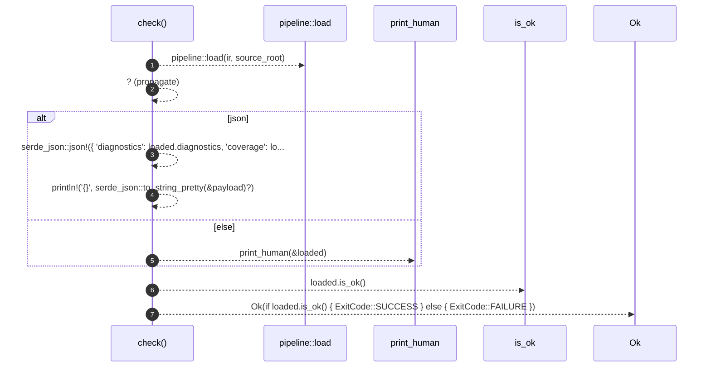

# `robby_cli::check`

[Self-model](../README.md) · [robby_cli](index.md)

| | |
|---|---|
| kind | `code.function` |
| signature | `fn check(ir: &std::path::Path, source_root: &std::path::Path, json: bool) -> Result<ExitCode>` |
| location | [`crates/robby-cli/src/main.rs:307`](../../../crates/robby-cli/src/main.rs#L307) |
| provenance | extractor · confidence 1.00 |

```rust
fn check(ir: &std::path::Path, source_root: &std::path::Path, json: bool) -> Result<ExitCode> {
    let loaded = pipeline::load(ir, source_root)?;

    if json {
        let payload = serde_json::json!({
            "diagnostics": loaded.diagnostics,
            "coverage": loaded.coverage,
            "ok": loaded.is_ok(),
        });
        println!("{}", serde_json::to_string_pretty(&payload)?);
    } else {
        print_human(&loaded);
    }

    Ok(if loaded.is_ok() {
        ExitCode::SUCCESS
    } else {
        ExitCode::FAILURE
    })
}
```



7 steps · 0 observed · 7 possible only

**Edges**

- calls → [`robby_render::pipeline::load`](../robby_render/pipeline/load.md)
- calls → [`robby_cli::print_human`](print-human.md)
- calls → [`robby_render::pipeline::impl Loaded::is_ok`](../robby_render/pipeline/index.md)

## References

- calls → [`robby_cli`](index.md) — print_human
- calls → [`robby_render::pipeline`](../robby_render/pipeline/index.md) — is_ok, load

## Referenced by

- calls ← [`robby_cli::run`](run.md)

