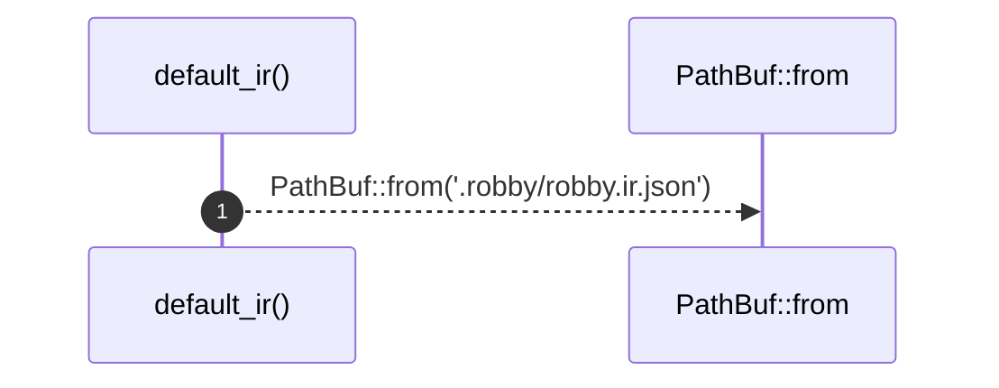

# `robby_cli::default_ir`

[Self-model](../README.md) · [robby_cli](index.md)

| | |
|---|---|
| kind | `code.function` |
| signature | `fn default_ir() -> PathBuf` |
| location | [`crates/robby-cli/src/main.rs:464`](../../../crates/robby-cli/src/main.rs#L464) |
| provenance | extractor · confidence 1.00 |

```rust
fn default_ir() -> PathBuf {
    PathBuf::from(".robby/robby.ir.json")
}
```



1 steps · 0 observed · 1 possible only

**Edges**

- calls → [`robby_ir::kind::impl From<&str> for Kind::from`](../robby_ir/kind/index.md)

## References

- calls → [`robby_ir::kind`](../robby_ir/kind/index.md) — from

