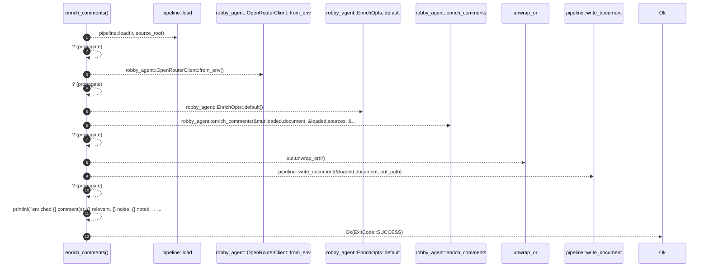

# `robby_cli::enrich_comments`

[Self-model](../README.md) · [robby_cli](index.md)

| | |
|---|---|
| kind | `code.function` |
| signature | `fn enrich_comments(     ir: &std::path::Path,     source_root: &std::path::Path,     out: Option<&std::path::Path>,     decision_model: Option<String>,     note_model: Option<String>,     limit: Option<usize>, ) -> Result<ExitCode>` |
| location | [`crates/robby-cli/src/main.rs:278`](../../../crates/robby-cli/src/main.rs#L278) |
| provenance | extractor · confidence 1.00 |

```rust
fn enrich_comments(
    ir: &std::path::Path,
    source_root: &std::path::Path,
    out: Option<&std::path::Path>,
    decision_model: Option<String>,
    note_model: Option<String>,
    limit: Option<usize>,
) -> Result<ExitCode> {
    let mut loaded = pipeline::load(ir, source_root)?;
    let client = robby_agent::OpenRouterClient::from_env()?;
    let mut opts = robby_agent::EnrichOpts::default();
    if let Some(m) = decision_model {
        opts.decision_model = m;
    }
    if let Some(m) = note_model {
        opts.note_model = m;
    }
    opts.limit = limit;

    let stats = robby_agent::enrich_comments(&mut loaded.document, &loaded.sources, &client, &opts)?;
    let out_path = out.unwrap_or(ir);
    pipeline::write_document(&loaded.document, out_path)?;
    println!(
        "enriched {} comment(s): {} relevant, {} noise, {} noted → {}",
        stats.decided, stats.relevant, stats.noise, stats.noted, out_path.display()
    );
    Ok(ExitCode::SUCCESS)
}
```



12 steps · 0 observed · 12 possible only

**Edges**

- calls → [`robby_render::pipeline::load`](../robby_render/pipeline/load.md)
- calls → [`robby_agent::openrouter::impl OpenRouterClient::from_env`](../robby_agent/openrouter/index.md)
- calls → [`robby_ir::process::impl Default for Process::default`](../robby_ir/process/index.md)
- calls → [`robby_cli::enrich_comments`](enrich-comments.md)
- calls → [`robby_render::pipeline::write_document`](../robby_render/pipeline/write-document.md)

## References

- calls → [`robby_agent::openrouter`](../robby_agent/openrouter/index.md) — from_env
- calls → [`robby_ir::process`](../robby_ir/process/index.md) — default
- calls → [`robby_render::pipeline`](../robby_render/pipeline/index.md) — load, write_document

## Referenced by

- calls ← [`robby_cli::run`](run.md)

