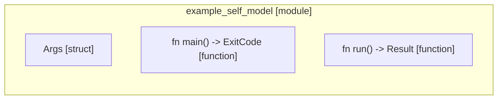

# `robby_cli::example_self_model`

[Self-model](../../README.md) · [robby_cli](../index.md)

| | |
|---|---|
| kind | `code.module` |
| provenance | extractor · confidence 1.00 |
| nodes | 15 |

## Items

| Item | Kind | Steps | Location |
|---|---|---:|---|
| [`Args`](args.md) | `code.struct` | — | `crates/robby-cli/examples/self-model.rs:27:1` |
| [`main`](main.md) | `code.function` | 3 | `crates/robby-cli/examples/self-model.rs:50:1` |
| [`run`](run.md) | `code.function` | 23 | `crates/robby-cli/examples/self-model.rs:60:1` |

## Imports

- `use std::path::PathBuf;`
- `use std::process::ExitCode;`
- `use anyhow::Result;`
- `use clap::Parser;`
- `use robby_render::pipeline;`

