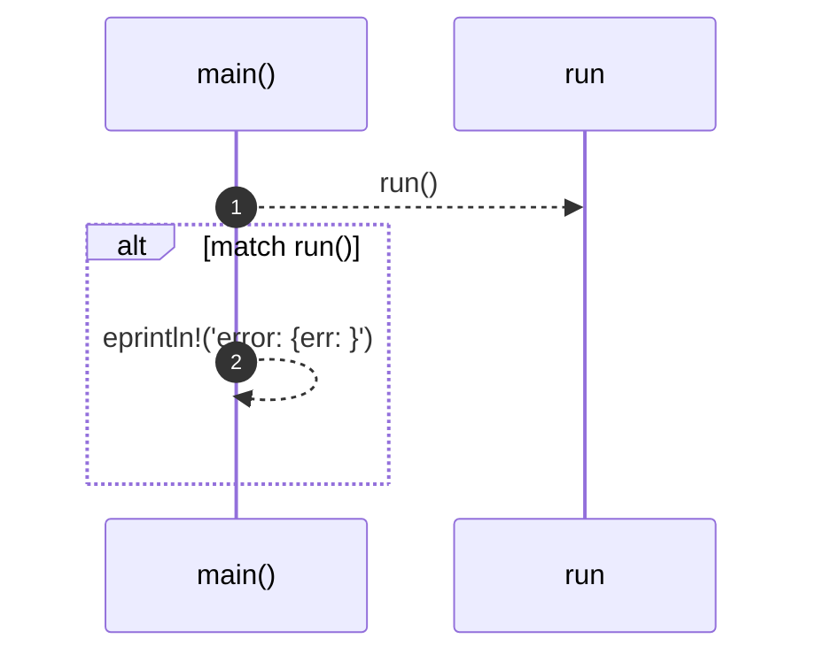
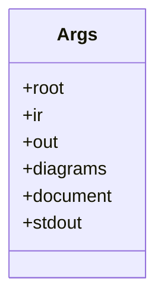
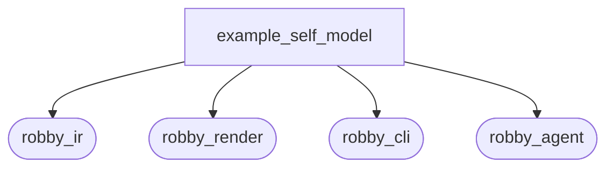
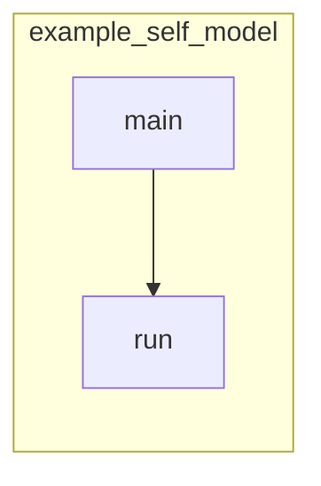

# `robby_cli::example_self_model`

[Self-model](../../README.md) · [robby_cli](../index.md)

| | |
|---|---|
| kind | `code.module` |
| provenance | extractor · confidence 1.00 |
| nodes | 15 |

## Entry

## Types

## Package diagram

## Module coupling

## Dependency matrix

| | example_self_model | robby_ir | robby_render | robby_cli | robby_agent |
|---|---:|---:|---:|---:|---:|
| **example_self_model** | · | 1 | 6 | 1 | 1 |
| **robby_ir** | | · | | | |
| **robby_render** | | | · | | |
| **robby_cli** | | | | · | |
| **robby_agent** | | | | | · |
## References

- calls → [`robby_agent::model`](../../robby_agent/model/index.md) — parse
- calls → [`robby_cli`](../index.md) — extract
- calls → [`robby_ir::coverage`](../../robby_ir/coverage/index.md) — failures
- calls → [`robby_render::pipeline`](../../robby_render/pipeline/index.md) — 6 items

## Items

| Item | Kind | Steps | Location |
|---|---|---:|---|
| [`Args`](args.md) | `code.struct` | — | `crates/robby-cli/examples/self-model.rs:27:1` |
| [`main`](main.md) | `code.function` | 2 | `crates/robby-cli/examples/self-model.rs:50:1` |
| [`run`](run.md) | `code.function` | 27 | `crates/robby-cli/examples/self-model.rs:60:1` |

## Imports

- `use std::path::PathBuf;`
- `use std::process::ExitCode;`
- `use anyhow::Result;`
- `use clap::Parser;`
- [`use robby_render::pipeline;`](../../robby_render/pipeline/index.md)

