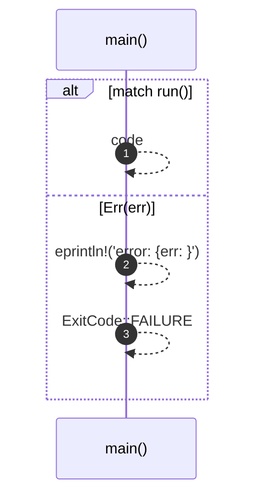

# `robby_cli::example_self_model::main`

[Self-model](../../README.md) · [example_self_model](index.md)

| | |
|---|---|
| kind | `code.function` |
| signature | `fn main() -> ExitCode` |
| location | [`crates/robby-cli/examples/self-model.rs:50`](../../../../crates/robby-cli/examples/self-model.rs#L50) |
| provenance | extractor · confidence 1.00 |

```rust
fn main() -> ExitCode {
    match run() {
        Ok(code) => code,
        Err(err) => {
            eprintln!("error: {err:#}");
            ExitCode::FAILURE
        }
    }
}
```



3 steps · 0 observed · 3 possible only

