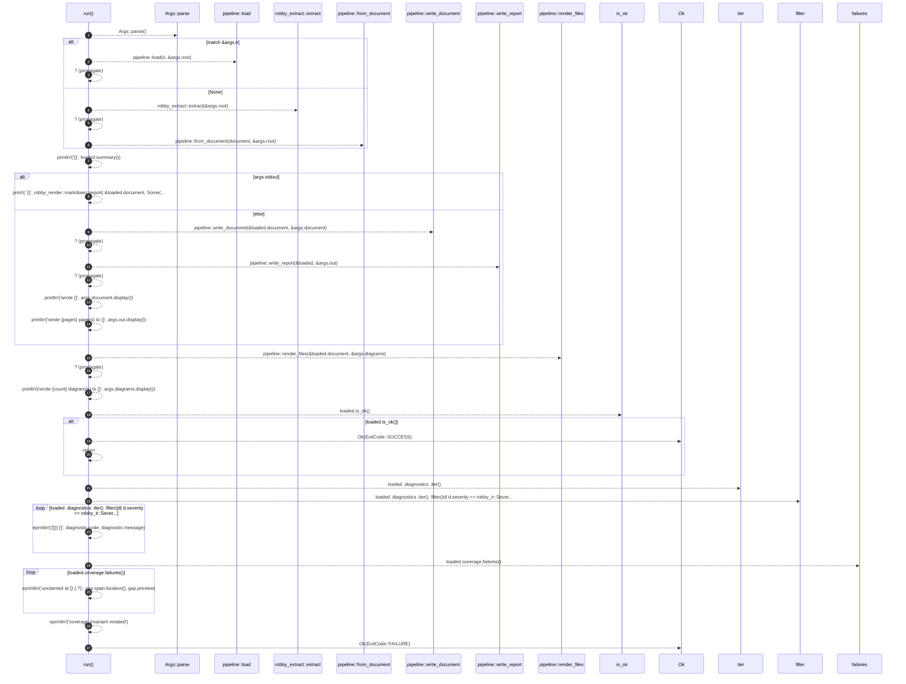

# `robby_cli::example_self_model::run`

[Self-model](../../README.md) · [example_self_model](index.md)

| | |
|---|---|
| kind | `code.function` |
| signature | `fn run() -> Result<ExitCode>` |
| location | [`crates/robby-cli/examples/self-model.rs:60`](../../../../crates/robby-cli/examples/self-model.rs#L60) |
| provenance | extractor · confidence 1.00 |

```rust
fn run() -> Result<ExitCode> {
    let args = Args::parse();

    let loaded = match &args.ir {
        Some(ir) => pipeline::load(ir, &args.root)?,
        None => {
            let document = robby_extract::extract(&args.root)?;
            pipeline::from_document(document, &args.root)
        }
    };

    println!("{}", loaded.summary());

    if args.stdout {
        print!(
            "{}",
            robby_render::markdown::report(
                &loaded.document,
                Some(&loaded.coverage),
                Some(&loaded.sources)
            )
        );
    } else {
        pipeline::write_document(&loaded.document, &args.document)?;
        let pages = pipeline::write_report(&loaded, &args.out)?;
        println!("wrote {}", args.document.display());
        println!("wrote {pages} page(s) to {}", args.out.display());
    }

    let count = pipeline::render_files(&loaded.document, &args.diagrams)?;
    println!("wrote {count} diagram(s) to {}", args.diagrams.display());

    if loaded.is_ok() {
        return Ok(ExitCode::SUCCESS);
    }

    for diagnostic in loaded
        .diagnostics
        .iter()
        .filter(|d| d.severity == robby_ir::Severity::Error)
    {
        eprintln!("[{}] {}", diagnostic.code, diagnostic.message);
    }
    for (_file, gap) in loaded.coverage.failures() {
        eprintln!("unclaimed at {}  {:?}", gap.span.location(), gap.preview);
    }
    eprintln!("coverage invariant violated");
    Ok(ExitCode::FAILURE)
}
```



27 steps · 0 observed · 27 possible only

**Edges**

- calls → [`robby_agent::model::impl Verdict::parse`](../../robby_agent/model/index.md)
- calls → [`robby_render::pipeline::load`](../../robby_render/pipeline/load.md)
- calls → [`robby_cli::extract`](../extract.md)
- calls → [`robby_render::pipeline::from_document`](../../robby_render/pipeline/from-document.md)
- calls → [`robby_render::pipeline::write_document`](../../robby_render/pipeline/write-document.md)
- calls → [`robby_render::pipeline::write_report`](../../robby_render/pipeline/write-report.md)
- calls → [`robby_render::pipeline::render_files`](../../robby_render/pipeline/render-files.md)
- calls → [`robby_render::pipeline::impl Loaded::is_ok`](../../robby_render/pipeline/index.md)
- calls → [`robby_ir::coverage::impl CoverageReport::failures`](../../robby_ir/coverage/index.md)

## References

- calls → [`robby_agent::model`](../../robby_agent/model/index.md) — parse
- calls → [`robby_cli`](../index.md) — extract
- calls → [`robby_ir::coverage`](../../robby_ir/coverage/index.md) — failures
- calls → [`robby_render::pipeline`](../../robby_render/pipeline/index.md) — 6 items

## Referenced by

- calls ← [`robby_cli::example_self_model::main`](main.md)

