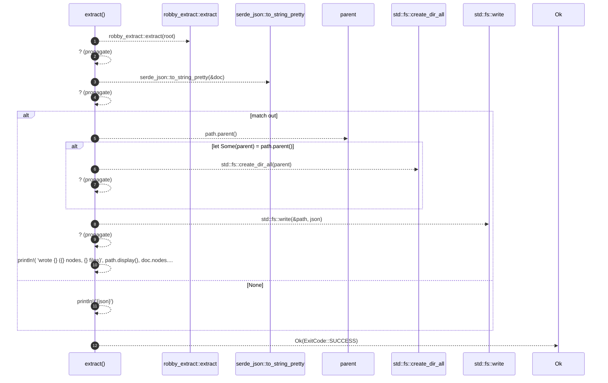

# `robby_cli::extract`

[Self-model](../README.md) · [robby_cli](index.md)

| | |
|---|---|
| kind | `code.function` |
| signature | `fn extract(root: &std::path::Path, out: Option<PathBuf>) -> Result<ExitCode>` |
| location | [`crates/robby-cli/src/main.rs:323`](../../../crates/robby-cli/src/main.rs#L323) |
| provenance | extractor · confidence 1.00 |

```rust
fn extract(root: &std::path::Path, out: Option<PathBuf>) -> Result<ExitCode> {
    let doc = robby_extract::extract(root)?;
    let json = serde_json::to_string_pretty(&doc)?;
    match out {
        Some(path) => {
            if let Some(parent) = path.parent() {
                std::fs::create_dir_all(parent)?;
            }
            std::fs::write(&path, json)?;
            println!(
                "wrote {} ({} nodes, {} files)",
                path.display(),
                doc.nodes.len(),
                doc.files.len()
            );
        }
        None => println!("{json}"),
    }
    Ok(ExitCode::SUCCESS)
}
```



12 steps · 0 observed · 12 possible only

**Edges**

- calls → [`robby_cli::extract`](extract.md)

## Referenced by

- calls ← [`robby_cli::build::main`](build/main.md)
- calls ← [`robby_cli::example_self_model::run`](example_self_model/run.md)
- calls ← [`robby_cli::run`](run.md)
- calls ← [`robby_render::test_tree::pages`](../robby_render/test_tree/pages.md)

