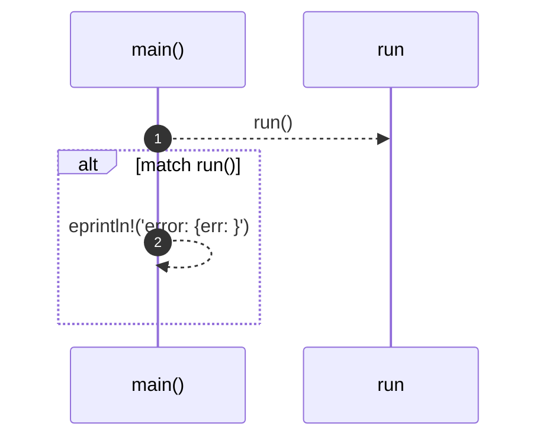
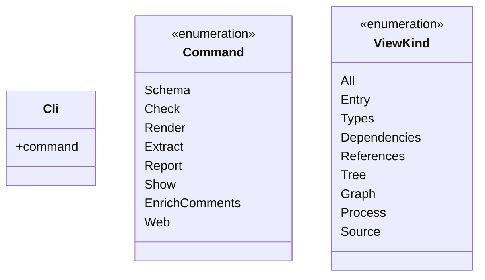
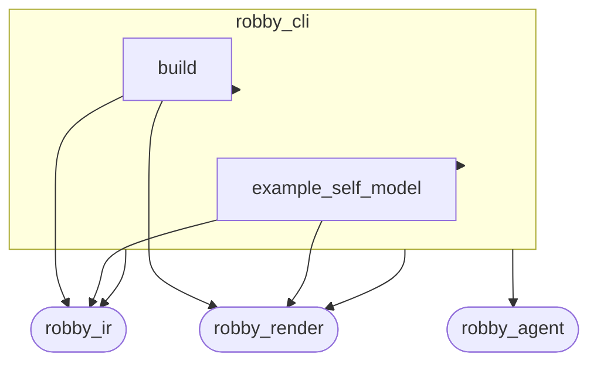
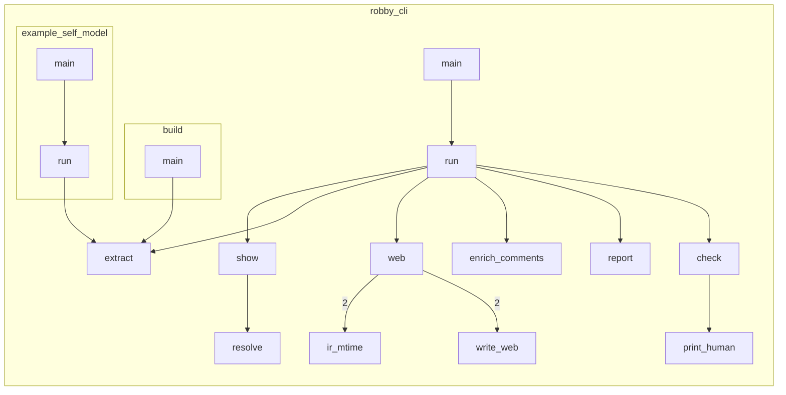

# `robby_cli`

[Self-model](../README.md)

| | |
|---|---|
| kind | `code.crate` |
| provenance | extractor · confidence 1.00 |
| nodes | 64 |

## Entry



## Types



## Package diagram



## Module coupling



## Dependency matrix

| | build | example_self_model | robby_cli | robby_ir | robby_render | robby_agent |
|---|---:|---:|---:|---:|---:|---:|
| **build** | · | | 1 | 2 | 5 | |
| **example_self_model** | | · | 1 | 2 | 6 | |
| **robby_cli** | | | · | 9 | 15 | 1 |
| **robby_ir** | | | | · | | |
| **robby_render** | | | | | · | |
| **robby_agent** | | | | | | · |

## Comments

- `crates/robby-cli/src/main.rs:487:1` (docs, `robby_cli::resolve`): "Resolve an exact fqn, an id, or a unique suffix / bare name."
  ```
  /// Resolve an exact fqn, an id, or a unique suffix / bare name.
  fn resolve<'a>(doc: &'a Document, path: &str) -> Result<&'a Node> {
      if let Some(node) = doc
          .nodes
          .values()
          .find(|node| node.fqn == path || node.id.as_str() == path)
      {
          return Ok(node);
      }
  
      let suffix = format!("::{path}");
      let mut matches: Vec<&Node> = doc
          .nodes
          .values()
          .filter(|node| node.fqn.ends_with(&suffix) || node.name == path)
          .collect();
  
      match matches.len() {
          0 => bail!("no node matches `{path}`"),
          1 => Ok(matches.remove(0)),
          _ => {
              matches.sort_by(|a, b| a.fqn.cmp(&b.fqn));
              let mut message = format!("`{path}` is ambiguous ({} matches):", matches.len());
              for node in matches.iter().take(20) {
                  let _ = write!(message, "\n  {}  [{}]", node.fqn, node.kind);
              }
              if matches.len() > 20 {
                  let _ = write!(message, "\n  … {} more", matches.len() - 20);
              }
              bail!(message)
          }
      }
  }
  ```
## References

- calls → [`robby_agent::openrouter`](../robby_agent/openrouter/index.md) — from_env
- calls → [`robby_ir`](../robby_ir/index.md) — schema_json
- calls → [`robby_ir::coverage`](../robby_ir/coverage/index.md) — failures, is_failure, worst_first
- calls → [`robby_ir::kind`](../robby_ir/kind/index.md) — as_str, from, new
- calls → [`robby_ir::process`](../robby_ir/process/index.md) — default
- calls → [`robby_ir::run`](../robby_ir/run/index.md) — parse
- calls → [`robby_render::pipeline`](../robby_render/pipeline/index.md) — 6 items
- calls → [`robby_render::report`](../robby_render/report/index.md) — push
- calls → [`robby_render::tui`](../robby_render/tui/index.md) — tree
- calls → [`robby_render::view::select`](../robby_render/view/select/index.md) — collect
- calls → [`robby_render::web`](../robby_render/web/index.md) — write_site

## Referenced by

- calls ← [`robby_render::test_tree::pages`](../robby_render/test_tree/pages.md)

## Modules

- [`build`](build/index.md) — 5 nodes
- [`example_self_model`](example_self_model/index.md) — 15 nodes

## Items

| Item | Kind | Steps | Location |
|---|---|---:|---|
| [`Cli`](cli.md) | `code.struct` | — | `crates/robby-cli/src/main.rs:16:1` |
| [`Command`](command.md) | `code.enum` | — | `crates/robby-cli/src/main.rs:27:1` |
| [`ViewKind`](viewkind.md) | `code.enum` | — | `crates/robby-cli/src/main.rs:136:1` |
| [`main`](main.md) | `code.function` | 2 | `crates/robby-cli/src/main.rs:149:1` |
| [`run`](run.md) | `code.function` | 26 | `crates/robby-cli/src/main.rs:159:1` |
| [`web`](web.md) | `code.function` | 13 | `crates/robby-cli/src/main.rs:230:1` |
| [`write_web`](write-web.md) | `code.function` | 3 | `crates/robby-cli/src/main.rs:265:1` |
| [`ir_mtime`](ir-mtime.md) | `code.function` | 4 | `crates/robby-cli/src/main.rs:274:1` |
| [`enrich_comments`](enrich-comments.md) | `code.function` | 12 | `crates/robby-cli/src/main.rs:278:1` |
| [`check`](check.md) | `code.function` | 7 | `crates/robby-cli/src/main.rs:307:1` |
| [`print_human`](print-human.md) | `code.function` | 14 | `crates/robby-cli/src/main.rs:328:1` |
| [`extract`](extract.md) | `code.function` | 12 | `crates/robby-cli/src/main.rs:369:1` |
| [`report`](report.md) | `code.function` | 7 | `crates/robby-cli/src/main.rs:390:1` |
| [`show`](show.md) | `code.function` | 21 | `crates/robby-cli/src/main.rs:413:1` |
| [`default_ir`](default-ir.md) | `code.function` | 1 | `crates/robby-cli/src/main.rs:464:1` |
| [`workspace`](workspace.md) | `code.function` | 7 | `crates/robby-cli/src/main.rs:468:1` |
| [`resolve`](resolve.md) | `code.function` | 23 | `crates/robby-cli/src/main.rs:487:1` |

## Imports

- `use std::fmt::Write as _;`
- `use std::path::PathBuf;`
- `use std::process::ExitCode;`
- `use anyhow::{Result, bail};`
- `use clap::{Parser, Subcommand, ValueEnum};`
- [`use robby_ir::{Document, Node, Severity};`](../robby_ir/index.md)
- [`use robby_render::pipeline;`](../robby_render/pipeline/index.md)
- [`use robby_render::tui;`](../robby_render/tui/index.md)

